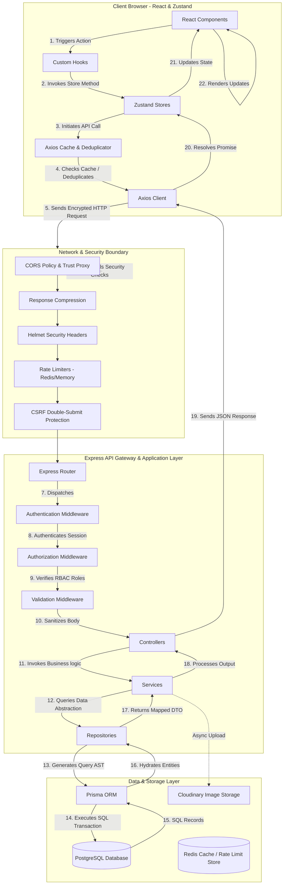
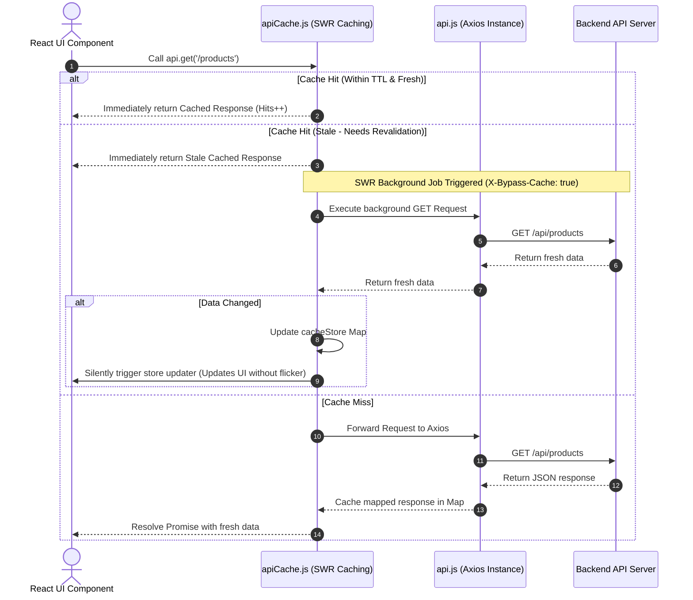
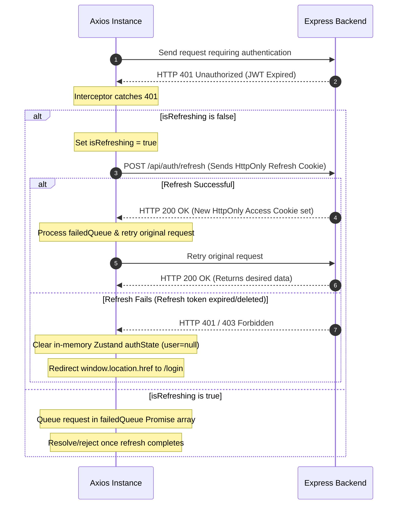
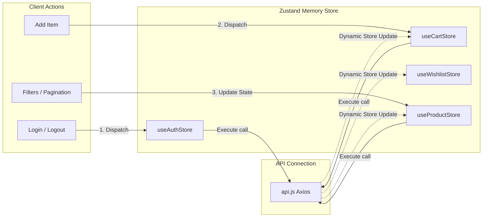
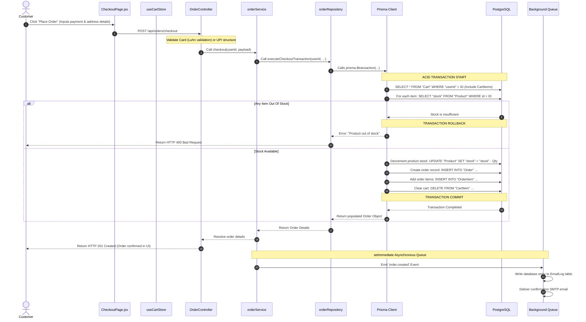
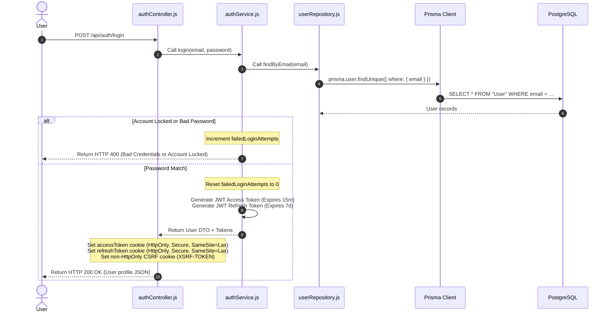
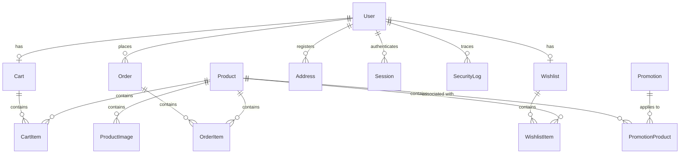
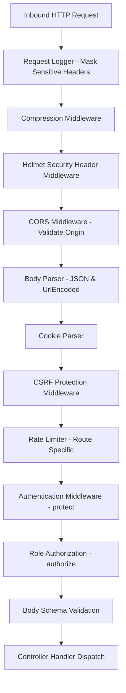

# 📐 Enterprise API Architecture & Data Flow Audit Report

> **Document Type**: Technical Architecture & Data Flow Audit  
> **Target Audience**: Technical Managers, Lead Architects, and Onboarding Developers  
> **Status**: Completed  
> **Workspace**: [eCommerce Workspace](file:///c:/Users/Admin/Desktop/eCommerce)

---

## 1. High-Level System Architecture

The application is structured as a modern, decoupled client-server architecture with a strict unidirectional data flow on the frontend and an asynchronous, service-repository-driven design on the backend.



---

## 2. Comprehensive Layer Responsibility Breakdown

This section outlines the exact purpose, responsibility, file mapping, and inputs/outputs of every architectural layer in the project.

### 2.1 Frontend Layers

#### 1. React Components
*   **Purpose**: Render UI elements and bind event handlers to custom hooks or stores.
*   **Responsibilities**: Display presentation states, bind inputs, call loading indicators/skeletons, trigger user events.
*   **Files Involved**: All files in [frontend/src/pages](file:///c:/Users/Admin/Desktop/eCommerce/frontend/src/pages) and [frontend/src/components](file:///c:/Users/Admin/Desktop/eCommerce/frontend/src/components).
*   **Important Functions**: Functional component renders, `useEffect` hooks for local mount events.
*   **Input**: User click actions, local state variables, store selectors.
*   **Output**: HTML DOM nodes, JSX render outputs, triggers to state stores.
*   **Why It Exists**: To provide a declarative, visual presentation interface for the end-user.
*   **Consequence of Absence**: The application would have no user interface; raw JSON inputs/outputs would require manual CLI or API client interactions.

#### 2. Custom Hooks
*   **Purpose**: Abstract complex UI lifecycle operations, local state tracking, or direct bindings.
*   **Responsibilities**: Manage form input validation logic, toggle visibility states, handle screen resize event listeners.
*   **Files Involved**: Files inside [frontend/src/hooks](file:///c:/Users/Admin/Desktop/eCommerce/frontend/src/hooks).
*   **Input**: Arguments passed during hook invocation.
*   **Output**: Reusable states, helper functions.
*   **Why It Exists**: Separates component UI declarations from pure functional controller logic inside React.
*   **Consequence of Absence**: Components would contain massive amounts of duplicate code handling simple tasks like form inputs, loading overlays, and toggles.

#### 3. Zustand Stores
*   **Purpose**: Global in-memory application state management.
*   **Responsibilities**: Retain user sessions, cart contents, products list, order history, and handle async actions by executing API requests.
*   **Files Involved**: Files inside [frontend/src/store](file:///c:/Users/Admin/Desktop/eCommerce/frontend/src/store).
*   **Important Functions**: `create()`, `set()`, `get()`, actions like `login()`, `fetchCart()`, `checkout()`.
*   **Input**: Data objects from UI triggers (credentials, product IDs, quantities).
*   **Output**: Synchronized global state objects, trigger re-renders on components selecting modified keys.
*   **Why It Exists**: Avoids "prop-drilling" and provides a single source of truth for UI state that survives component unmounts.
*   **Consequence of Absence**: State would be scattered across components, resulting in desynchronized data (e.g., cart badge count mismatching checkout contents).

#### 4. Axios Client (`api.js`)
*   **Purpose**: Standardized HTTP client for executing requests.
*   **Responsibilities**: Configure default headers, base URLs, credentials configuration, and manage network error states.
*   **Files Involved**: [frontend/src/services/api.js](file:///c:/Users/Admin/Desktop/eCommerce/frontend/src/services/api.js).
*   **Input**: Request parameters, payload objects, URI paths.
*   **Output**: Mapped network Promises resolving to JSON response payloads.
*   **Why It Exists**: Provides an abstraction over the native browser `fetch` API, enabling automatic request mapping, headers configuration, and timeouts.
*   **Consequence of Absence**: Every network call would require manual parsing of responses, conversion of objects to query params, and manual cookie configuration.

#### 5. Axios Interceptors & Cache Layer
*   **Purpose**: Silent session restoration, request deduplication, and GET caching.
*   **Responsibilities**: Deduplicate concurrent network requests, cache GET results using a custom Stale-While-Revalidate (SWR) cache, automatically attach CSRF headers, and capture `401 Unauthorized` states to perform token refreshes.
*   **Files Involved**: [frontend/src/services/api.js](file:///c:/Users/Admin/Desktop/eCommerce/frontend/src/services/api.js), [frontend/src/services/apiCache.js](file:///c:/Users/Admin/Desktop/eCommerce/frontend/src/services/apiCache.js).
*   **Important Functions**: `interceptors.response.use()`, `handleCachedRequest()`, `deduplicateRequest()`.
*   **Input**: Failed request configs, HTTP headers, cached entries.
*   **Output**: Automated token refresh HTTP calls, resolved Promises from deduplicated streams, or cached payloads.
*   **Why It Exists**: Standardizes error handling (such as token expiration), protects against CSRF via Double-Submit cookies, and optimizes page load times via client caching.
*   **Consequence of Absence**: Token expirations would force immediate logouts; multiple identical network requests would fire concurrently, slowing page load speeds.

---

### 2.2 Backend Layers

#### 1. Express Router
*   **Purpose**: Inbound API route registration and endpoint matching.
*   **Responsibilities**: Map URI paths and HTTP verbs to appropriate controller functions.
*   **Files Involved**: All files in [backend/src/routes](file:///c:/Users/Admin/Desktop/eCommerce/backend/src/routes).
*   **Input**: HTTP request stream.
*   **Output**: Dispatches to corresponding middleware chain and controller actions.
*   **Why It Exists**: Declares the public API contract of the server in an organized mapping.
*   **Consequence of Absence**: The application would require a massive switch statement inside the server core to read the URL path and call functions manually.

#### 2. Authentication Middleware (`protect`)
*   **Purpose**: Validates session integrity.
*   **Responsibilities**: Parse accessToken cookies or Bearer tokens, decode JWTs, verify user exists in database, validate `tokenVersion` to prevent active session hijack after logout or password reset.
*   **Files Involved**: [backend/src/middleware/authMiddleware.js](file:///c:/Users/Admin/Desktop/eCommerce/backend/src/middleware/authMiddleware.js).
*   **Important Functions**: `protect()`.
*   **Input**: Request cookies or Authorization headers.
*   **Output**: Mapped `req.user` payload, or block execution with `401 Unauthorized`.
*   **Why It Exists**: Secures routes so that only users with active, valid sessions can access secure resources.
*   **Consequence of Absence**: Any user or attacker could access sensitive user profiles, cart info, or admin functions without credentials.

#### 3. Authorization Middleware (`authorize`)
*   **Purpose**: Role-Based Access Control (RBAC).
*   **Responsibilities**: Match the authenticated user's role against allowed route roles (`CUSTOMER`, `ADMIN`, `SUPER_ADMIN`).
*   **Files Involved**: [backend/src/middleware/roleMiddleware.js](file:///c:/Users/Admin/Desktop/eCommerce/backend/src/middleware/roleMiddleware.js).
*   **Important Functions**: `authorize()`.
*   **Input**: Mapped user role on `req.user`.
*   **Output**: Proceeds to next step, or halts with `403 Forbidden`.
*   **Why It Exists**: Restricts standard customer users from accessing admin-specific settings, product lists, or financial data.
*   **Consequence of Absence**: Customers could call admin endpoints directly to update system settings or view logs.

#### 4. Validation Middleware (`validate`)
*   **Purpose**: Payload schema enforcement.
*   **Responsibilities**: Validate query params, URL parameters, and body schemas using validator definitions.
*   **Files Involved**: [backend/src/middleware/validationMiddleware.js](file:///c:/Users/Admin/Desktop/eCommerce/backend/src/middleware/validationMiddleware.js), [backend/src/validations](file:///c:/Users/Admin/Desktop/eCommerce/backend/src/validations).
*   **Input**: `req.body`, `req.query`, `req.params`.
*   **Output**: Passes sanitized request, or blocks with `400 Bad Request`.
*   **Why It Exists**: Protects business logic and database queries from executing with malformed, missing, or malicious input variables.
*   **Consequence of Absence**: Malformed requests could crash services or lead to SQL injections or database inconsistencies (e.g., inserting negative product prices).

#### 5. Controller
*   **Purpose**: Orchestrate HTTP request variables and responses.
*   **Responsibilities**: Extract request variables, check basic constraints, delegate actions to Services, and format output standard payloads (`successResponse`/`errorResponse`).
*   **Files Involved**: All files in [backend/src/controllers](file:///c:/Users/Admin/Desktop/eCommerce/backend/src/controllers).
*   **Input**: Express `req`, `res`, `next` objects.
*   **Output**: Mapped JSON objects sent via HTTP response streams.
*   **Why It Exists**: Isolates Express-specific routing details (req/res objects, cookies, headers) from pure business and database queries.
*   **Consequence of Absence**: Business logic would be tightly coupled to the HTTP framework, making unit tests difficult and preventing changes in the controller layer (e.g., swapping Express for Koa).

#### 6. Service
*   **Purpose**: Pure business logic execution.
*   **Responsibilities**: Run calculations, validation constraints, coordinate multiple database operations, execute async background tasks, and parse results.
*   **Files Involved**: All files in [backend/src/services](file:///c:/Users/Admin/Desktop/eCommerce/backend/src/services).
*   **Input**: Pure Javascript arguments passed by the controllers.
*   **Output**: Clean, processed Javascript objects or Arrays.
*   **Why It Exists**: Ensures all application business logic (e.g., checkout totals, inventory threshold checks) resides in a testable, framework-independent layer.
*   **Consequence of Absence**: Controllers would be bloated with complex business logic, leading to duplicate rules across different controllers.

#### 7. Repository
*   **Purpose**: Database query abstraction layer.
*   **Responsibilities**: Construct database queries, manage queries formatting, translate raw objects into database-mapped schema structures, and orchestrate SQL Transactions.
*   **Files Involved**: All files in [backend/src/repositories](file:///c:/Users/Admin/Desktop/eCommerce/backend/src/repositories).
*   **Input**: Filter parameters, entity identifiers, query limits, search terms.
*   **Output**: Mapped objects, SQL transaction resolutions.
*   **Why It Exists**: Abstracts database-specific querying mechanics (Prisma, SQL dialects) from business services, allowing developers to modify schemas without rewriting logic.
*   **Consequence of Absence**: Service layers would perform direct database transactions, making swapping database engines or ORMs near-impossible.

#### 8. Prisma ORM (`prisma.js`)
*   **Purpose**: Query execution engine and object-relational mapping.
*   **Responsibilities**: Map Javascript/Typescript objects directly to database tables, check types, run schema migrations, and manage database connection pools.
*   **Files Involved**: [backend/src/lib/prisma.js](file:///c:/Users/Admin/Desktop/eCommerce/backend/src/lib/prisma.js).
*   **Input**: Query instructions via the Prisma JS client client wrapper.
*   **Output**: Pure Javascript objects representing rows of DB tables.
*   **Why It Exists**: Eliminates the need to write raw SQL strings by generating type-safe, optimized query trees.
*   **Consequence of Absence**: Developers would write manual SQL query strings, which increases the likelihood of typos, SQL injection risks, and syntax bugs.

#### 9. PostgreSQL Database
*   **Purpose**: Persistent relational data store.
*   **Responsibilities**: Permanently retain system records, enforce constraints (unique, foreign key checks), handle indexing, and resolve concurrent transactions safely.
*   **Input**: SQL operations.
*   **Output**: Relational row matrices, execution statuses.
*   **Why It Exists**: To guarantee transaction durability, data consistency, and reliable retrieval of store objects.
*   **Consequence of Absence**: All data would reside in volatile memory, resetting completely upon server restarts.

---

## 3. Deep Dive: Axios Configuration, Interceptors, and Cache Layer

The frontend Axios client features a robust custom caching and silent authentication lifecycle management system.



### 3.1 Custom Caching (apiCache.js)
1.  **Request Deduplication**: Uses `inFlightRequests` Map containing active Promises. If a component requests `GET /api/products` while another component has that request running, both listen to the same Promise, saving network roundtrips.
2.  **Stale-While-Revalidate (SWR)**: Retains entries in `cacheStore` Map with an expiration date (`DEFAULT_TTL` = 5 mins). If requested within revalidation threshold (`REVALIDATE_AFTER` = 60s), the cache is returned instantly. If it is older than 60s but under 5 mins, the cached copy is returned to prevent screen flicker, and a background request is fired. If data returned from the server has changed, the registered Zustand store is updated silently.
3.  **Invalidation Rules**: When a modifying request (`POST`, `PUT`, `DELETE`) succeeds, the cache matching that entity is cleared. E.g., adding to cart invalidates `/cart` cache, and creating a product invalidates `/products` cache.

### 3.2 Silent Authentication & Response Interceptor Lifecycle



*   **Cookie-based Authentication**: JWT tokens are not stored on the client. Browser automatically handles `HttpOnly` security cookies. `withCredentials: true` is set globally.
*   **CSRF double-submit protection**: Axios automatically reads the cookie value `XSRF-TOKEN` and appends it to state-changing requests inside the `X-XSRF-TOKEN` header.

---

## 4. Zustand Store Architecture

Zustand stores are kept entirely in memory. The configuration prevents local storage persistence, reducing token hijack vectors.



*   **State Separation**: 
    *   `useAuthStore`: Sessions, login status, user role parameters.
    *   `useCartStore`: Cart array, subtotal, shipping configurations.
    *   `useProductStore`: Product lists, paginated counts, catalog category variables.
*   **Optimistic Updates**: Implemented on wishlist operations. E.g., clicking favorite adds it to UI immediately. If the API fails, the store performs a rollback operation.
*   **Loading & Error states**: All stores expose `isLoading` and `error` parameters, utilized by the UI components to render skeleton loaders or toast alerts.

---

## 5. Complete Request & Response Flow: Products Admin Table

This trace shows how an admin action on the products list goes through the entire React, Express, Prisma, and PostgreSQL stack.

### 5.1 Step-by-Step Execution Diagram

```mermaid
sequenceDiagram
    autonumber
    participant UI as AdminProducts.jsx
    participant ZS as useProductStore
    participant AX as apiCache.js & api.js
    participant ER as Express Router
    participant AM as authMiddleware (protect)
    participant AC as ProductController
    participant AS as productService
    participant AR as productRepository
    participant PR as Prisma Client
    participant DB as PostgreSQL
    
    UI->>ZS: Click "Page 2" / triggers setPage(2)
    ZS->>AX: call api.get('/admin/products?page=2&limit=10')
    AX->>ER: GET /api/admin/products?page=2&limit=10
    
    Note over ER: Routes Match: router.use(protect)
    ER->>AM: Execute protect() middleware
    Note over AM: Validates accessToken cookie in database
    AM-->>ER: Authenticated req.user (ADMIN)
    
    ER->>AC: Calls getProducts()
    AC->>AS: Calls getProducts({ page: 2, limit: 10 })
    
    Note over AS: Service calculates skip & take:<br/>take = 10<br/>skip = (2 - 1) * 10 = 10
    
    AS->>AR: Calls findAll({ skip: 10, take: 10 })
    AR->>PR: Calls prisma.product.findMany({ skip: 10, take: 10, orderBy })
    PR->>DB: Executes SELECT * FROM "Product" ORDER BY "createdAt" DESC LIMIT 10 OFFSET 10;
    DB-->>PR: Return 10 matching database rows
    PR-->>AR: Return entity array
    AR-->>AS: Return mapped product entities
    AS-->>AC: Return products array + pagination details
    AC-->>AX: Send successResponse(res, data) (HTTP 200)
    AX-->>ZS: Resolve API call Promise
    ZS->>ZS: Update local products array & pagination state
    ZS-->>UI: Trigger state re-render
    Note over UI: UI table updates; skeleton loader hidden
```

### 5.2 Admin Table Implementations

| Admin Table | Page Component | Store | Axios Endpoint | Repository / Prisma Queries |
| :--- | :--- | :--- | :--- | :--- |
| **Products** | [AdminProducts.jsx](file:///c:/Users/Admin/Desktop/eCommerce/frontend/src/pages/admin/AdminProducts.jsx) | `useProductStore` | `GET /api/admin/products` | `productRepository.findAll` / `prisma.product.findMany` |
| **Orders** | [AdminOrders.jsx](file:///c:/Users/Admin/Desktop/eCommerce/frontend/src/pages/admin/AdminOrders.jsx) | `useAdminStore` | `GET /api/admin/orders` | `orderRepository.getAllOrders` / `prisma.order.findMany` |
| **Customers** | [AdminCustomers.jsx](file:///c:/Users/Admin/Desktop/eCommerce/frontend/src/pages/admin/AdminCustomers.jsx) | `useCustomerStore` | `GET /api/admin/customers` | `userRepository.findAll` / `prisma.user.findMany` |
| **Audit Logs** | [AuditLogsTab.jsx](file:///c:/Users/Admin/Desktop/eCommerce/frontend/src/pages/admin/settings/AuditLogsTab.jsx) | Local State | `GET /api/admin/security/audit-logs` | `prisma.securityLog.findMany` |
| **Analytics** | [Dashboard.jsx](file:///c:/Users/Admin/Desktop/eCommerce/frontend/src/pages/admin/Dashboard.jsx) | `useAdminStore` | `GET /api/admin/dashboard` | `adminRepository.getDashboardMetrics` |

---

## 6. E-Commerce Checkout & Purchase Transaction Flow

The purchase flow relies on database-level constraints and atomic transactions to guarantee that stock is allocated securely.



---

## 7. Authentication Endpoint Flow

All authorization checks verify token version numbers, ensuring that if a user changes their password, all active sessions are instantly terminated.



---

## 8. Database Schema & Architecture Mapping

The application uses PostgreSQL with Prisma ORM. Indexes are declared on hot tables to optimize query retrieval execution.

### 8.1 Database Indexes mapping

To optimize query speeds, database tables contain secondary indexes defined in `schema.prisma`:
*   `Product`: Indexes are placed on `stock`, `createdAt`, `category`, `name`, `brand`, `price`, and `finalPrice`. This speeds up store product searches, filtering, and sorting.
*   `Order`: Indexes exist on `userId`, `orderStatus`, `paymentStatus`, and `createdAt` to make dashboard chart aggregation queries fast.
*   `ProductImage`: Double index on `productId` and `isPrimary` to retrieve thumbnails quickly.

### 8.2 Database Schema Reference



---

## 9. Full Middleware Execution Sequence

All HTTP requests traverse the backend security and mapping middleware stack in this exact execution order:



---

## 10. Third-Party Infrastructure Services

The application integrates with the following external services to handle media assets and emails:

*   **Cloudinary**: Handled inside [backend/src/config/cloudinary.js](file:///c:/Users/Admin/Desktop/eCommerce/backend/src/config/cloudinary.js) and `productImageService.js`. When an admin uploads a product image, it is streamed to Cloudinary, which returns a public secure URL and a `publicId` that is saved in the database.
*   **SMTP Service**: Configured dynamically in [backend/src/services/emailService.js](file:///c:/Users/Admin/Desktop/eCommerce/backend/src/services/emailService.js). Used for transactional emails (e.g. signup, orders).
*   **Redis**: Integrated as a storage layer for express rate limits when a `REDIS_URL` is set, helping maintain rate limits across multiple server instances.
