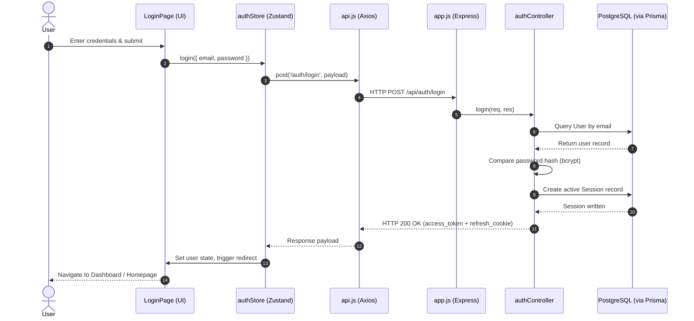
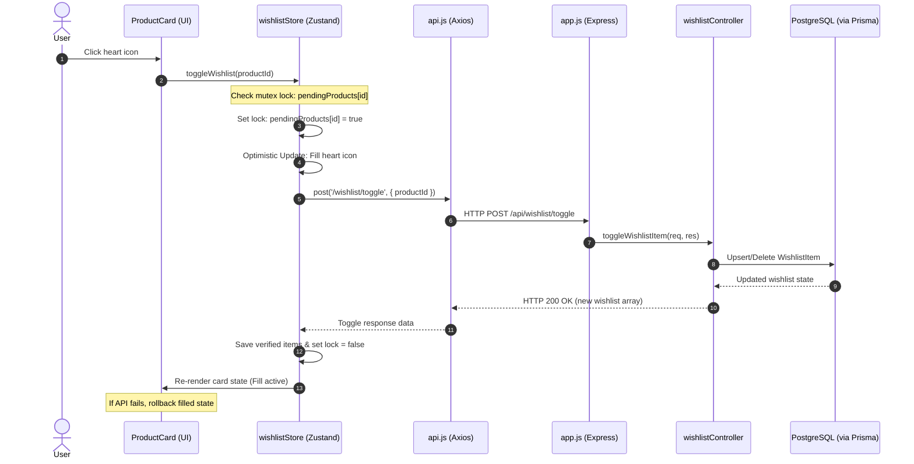
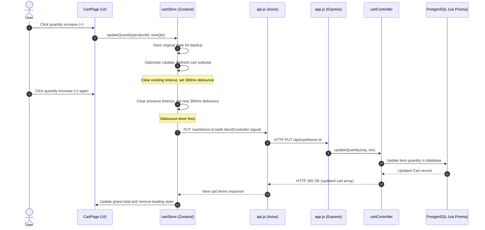
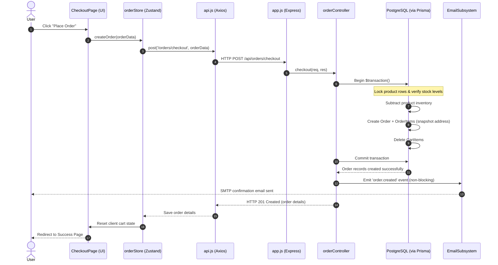

# Enterprise API Flow & Request Lifecycle Audit Report
## PRIYAL | Home Appliances Pvt Ltd. — eCommerce Platform

---

> **Classification:** Internal Technical Architecture & Lifecycle Audit  
> **Prepared For:** Principal Software Architect & Engineering Manager Review  
> **Scope:** End-to-end audit mapping Client Components, State Stores, HTTP clients, Router Layers, Middleware chains, controllers, services, repositories, and PostgreSQL database query execution.

---

## Phase 1 – Discover All APIs

The following table is a complete inventory of the Express REST API endpoints registered under `/api/*` in the application backend.

| Method | Endpoint | Used By | Authentication | Purpose |
|:---|:---|:---|:---|:---|
| **GET** | `/api/branding` | App Navbar, Footer, Auth Pages | None | Fetches store name, logo, custom theme colors, and email headers |
| **POST** | `/api/auth/register` | RegisterPage | None | Registers new customer, hashes password, emits Verification event |
| **POST** | `/api/auth/login` | LoginPage, AdminLoginPage | None | Authenticates credentials, checks lockout, signs JWT, stores refresh token |
| **POST** | `/api/auth/refresh` | Axios Response Interceptor | Cookie (Refresh Token) | Validates session, deletes old session, rotates new refresh + access token |
| **POST** | `/api/auth/logout` | Global Header, Profile Page | JWT (Access Token) | Deletes active refresh token session from DB, clears client cookies |
| **GET** | `/api/auth/me` | React App Initialization | JWT (Access Token) | Returns authenticated user profile using current access token |
| **PUT** | `/api/auth/password` | Profile Page (Password Reset) | JWT (Access Token) | Modifies password, increments tokenVersion to revoke old active tokens |
| **POST** | `/api/auth/forgot-password` | ForgotPasswordPage | None | Generates reset token in DB, emits email reset requested event |
| **POST** | `/api/auth/reset-password` | ResetPasswordPage | None | Verifies reset token, hashes new password, resets login failure attempts |
| **POST** | `/api/auth/verify-email` | VerifyEmailPage | None | Validates verification token, updates `isEmailVerified` to true |
| **GET** | `/api/products` | ProductListingPage, Customer Shop | None | Paginated search, filters by price/rating/stock/brand/category |
| **GET** | `/api/products/categories` | Catalog Sidebar, Main Filter Bar | None | Returns list of all unique categories present in the database |
| **GET** | `/api/products/search/suggestions` | SearchBar Autocomplete | None | Dynamic quick-search keyword autocomplete recommendations |
| **GET** | `/api/products/featured` | HomePage Carousel | None | Fetches products flagged as `featured` in database |
| **GET** | `/api/products/trending` | HomePage Section | None | Fetches products flagged as `trending` in database |
| **GET** | `/api/products/new` | HomePage Grid | None | Fetches products flagged as `new` in database |
| **GET** | `/api/products/best-sellers` | HomePage Section | None | Fetches products flagged as `bestSeller` in database |
| **GET** | `/api/products/recommended` | ProductDetail / Detail Carousel | None | Dynamic product recommendations based on tags or views |
| **GET** | `/api/products/:id` | ProductDetailsPage | None | Fetches single product, images, and category association |
| **GET** | `/api/products/:id/related` | ProductDetailsPage Carousel | None | Fetches items belonging to the same category/brand |
| **POST** | `/api/products` | AdminProductsPage | JWT + ADMIN | Creates a new database product record |
| **PUT** | `/api/products/:id` | AdminProductsPage Edit Modal | JWT + ADMIN | Updates product details, name, SKU, price, inventory |
| **DELETE** | `/api/products/:id` | AdminProductsPage Delete Trigger | JWT + ADMIN | Performs hard deletion of product and database references |
| **POST** | `/api/products/:id/images` | AdminProductsPage Image Manager | JWT + ADMIN | Multer parses and streams image uploads directly to Cloudinary |
| **DELETE** | `/api/products/:id/images/:imageId` | AdminProductsPage Image Manager | JWT + ADMIN | Deletes image file from Cloudinary and deletes DB reference |
| **PUT** | `/api/products/:id/images/reorder` | AdminProductsPage Drag-and-Drop | JWT + ADMIN | Updates the relative display order of product images in DB |
| **PUT** | `/api/products/:id/images/:imageId/primary` | AdminProductsPage Image Manager | JWT + ADMIN | Sets selected image as primary cover thumbnail of product |
| **GET** | `/api/cart` | CartPage, Navbar MiniCart | JWT (Access Token) | Fetches current user's active cart items from the database |
| **POST** | `/api/cart/items` | ProductListing, ProductDetails | JWT (Access Token) | Adds item or increments existing item quantity in cart |
| **PUT** | `/api/cart/items/:productId` | CartPage (Qty +/- Buttons) | JWT (Access Token) | Debounced update of item quantity in cart |
| **DELETE** | `/api/cart/items/:productId` | CartPage (Delete Button) | JWT (Access Token) | Removes item from cart (optimistic UI update on client) |
| **DELETE** | `/api/cart` | Checkout Flow Completed | JWT (Access Token) | Clears all cart items belonging to current customer |
| **GET** | `/api/wishlist` | WishlistDrawer | JWT (Access Token) | Fetches user's active wishlisted items with product details |
| **POST** | `/api/wishlist/toggle` | ProductCards, Wishlist Heart | JWT (Access Token) | Toggles item inclusion in wishlist with request lock |
| **POST** | `/api/orders/checkout` | CheckoutPage | JWT (Access Token) | Places order via ACID transaction; checks inventory, clears cart |
| **GET** | `/api/orders` | CustomerOrdersPage | JWT (Access Token) | Returns complete paginated order history of logged-in customer |
| **GET** | `/api/orders/:id` | CustomerOrderDetailsPage | JWT (Access Token) | Returns detailed breakdown of a single order (status, items) |
| **GET** | `/api/addresses` | AddressBookPage, CheckoutPage | JWT (Access Token) | Lists all saved addresses for the customer |
| **POST** | `/api/addresses` | AddressBook Add Modal | JWT (Access Token) | Creates a shipping or billing address in database |
| **PUT** | `/api/addresses/:id` | AddressBook Edit Modal | JWT (Access Token) | Modifies saved address fields (city, street, phone, defaults) |
| **DELETE** | `/api/addresses/:id` | AddressBook Remove Trigger | JWT (Access Token) | Deletes saved address record from user's account |
| **GET** | `/api/home/all` | Public HomePage | None | Combined landing page sections (Featured, New, Banners) |
| **PUT** | `/api/home/featured/order` | AdminHomeSettings | JWT + ADMIN | Modifies display ordering of homepage sections |
| **GET** | `/api/settings/public` | Public Pages (Store Branding) | None | Gets public settings (store name, customer care details) |
| **GET** | `/api/settings/:domain` | AdminSettings (Domain Tabs) | JWT + ADMIN | Fetches configuration options (SMTP config, Security locks) |
| **PUT** | `/api/settings/:domain` | AdminSettings (Save buttons) | JWT + ADMIN | Updates configuration (e.g. lockout limits, shipping fees) |
| **POST** | `/api/settings/smtp/test` | AdminSettings (SMTP test) | JWT + ADMIN | Verifies SMTP details by sending an live diagnostic test email |
| **GET** | `/api/promotions` | AdminOffersPage, Cart Checkout | JWT + ADMIN | Fetches all campaigns, coupons, and discounts |
| **POST** | `/api/promotions` | AdminOffersPage Add Modal | JWT + ADMIN | Creates discount campaign, coupon code or category discount |
| **PUT** | `/api/promotions/:id` | AdminOffersPage Edit Modal | JWT + ADMIN | Updates promotion duration, applicability or discount value |
| **DELETE** | `/api/promotions/:id` | AdminOffersPage Delete Trigger | JWT + ADMIN | Deletes promotion campaign from system database |
| **GET** | `/api/admin/dashboard` | AdminDashboardPage | JWT + ADMIN | Returns aggregated analytics metrics (sales, charts, order distribution) |
| **GET** | `/api/admin/dashboard/revenue` | Dashboard Revenue Drawer | JWT + ADMIN | Fetches detailed sales trend breakdown over time |
| **GET** | `/api/admin/dashboard/orders` | Dashboard Orders Drawer | JWT + ADMIN | Fetches granular statistics about orders received |
| **GET** | `/api/admin/dashboard/customers` | Dashboard Customers Drawer | JWT + ADMIN | Fetches details about customer growth and acquisition |
| **GET** | `/api/admin/dashboard/products` | Dashboard Products Drawer | JWT + ADMIN | Fetches view-to-sales ratios and stock analytics |
| **GET** | `/api/admin/dashboard/inventory-alerts` | Dashboard Stock Warning Box | JWT + ADMIN | Fetches alerts of products falling below minimum stock threshold |
| **GET** | `/api/admin/orders` | AdminOrdersPage | JWT + ADMIN | Lists all orders, paginated and filterable by status/date/amount |
| **PUT** | `/api/admin/orders/:id/status` | AdminOrdersPage Dropdown | JWT + ADMIN | Updates order status (PENDING -> SHIPPED, etc.) |
| **GET** | `/api/admin/customers` | AdminCustomersPage | JWT + ADMIN | Fetches list of registered customers, searchable and paginated |
| **PUT** | `/api/admin/customers/:id/status` | AdminCustomers Toggle Switch | JWT + ADMIN | Disables/enables customer login status |
| **GET** | `/api/admin/security/settings` | AdminSettings (Security Tab) | JWT + ADMIN | Returns system lockout threshold and session policies |
| **PUT** | `/api/admin/security/settings` | AdminSettings (Security Save) | JWT + ADMIN | Modifies lockout parameters and logs an admin audit entry |
| **GET** | `/api/admin/security/sessions` | AdminSettings Active Sessions | JWT + ADMIN | Lists active user sessions (IP, device info, browser type) |
| **DELETE** | `/api/admin/security/sessions/:id` | AdminSettings Session Terminate | JWT + ADMIN | Deletes a session hash from DB, effectively logging out the user |
| **POST** | `/api/admin/security/logout-all` | AdminSettings Force Reset | JWT + ADMIN | Force logs out all sessions and increments global `tokenVersion` |
| **GET** | `/api/admin/security/audit-logs` | AdminSettings Audits | JWT + ADMIN | Paginated query of administrative setting modifications |

---

## Phase 2 – Frontend API Mapping

For every route/page, the frontend maps UI events to Zustand actions, which communicate via the Axios instance to call the backend APIs.

```
Page Component (UI View)
  └── Custom Event Handler
        └── Zustand Store Hook (state action)
              └── API Service Call (axios request)
                    └── API Endpoint Call (HTTP payload)
```

Here is the exact request mapping for every page in the frontend application:

### 1. Login Page (`/login`)
- **Event:** User submits email and password.
- **Component Flow:** `LoginPage` ➔ `LoginForm` ➔ `handleSubmit()`
- **Zustand Store Call:** `authStore.login(credentials)`
- **Axios Call:** `api.post('/auth/login', credentials)`
- **Target Endpoint:** `POST /api/auth/login`

### 2. Register Page (`/register`)
- **Event:** User enters registration parameters (phone uses `react-phone-number-input`).
- **Component Flow:** `RegisterPage` ➔ `RegisterForm` ➔ `onSubmit()`
- **Zustand Store Call:** `authStore.register(userData)`
- **Axios Call:** `api.post('/auth/register', userData)`
- **Target Endpoint:** `POST /api/auth/register`

### 3. Forgot Password Page (`/forgot-password`)
- **Event:** User submits email for password recovery.
- **Component Flow:** `ForgotPasswordPage` ➔ `handleSubmit()`
- **Zustand Store Call:** `authStore.forgotPassword(email)`
- **Axios Call:** `api.post('/auth/forgot-password', { email })`
- **Target Endpoint:** `POST /api/auth/forgot-password`

### 4. Home Page (`/`)
- **Event:** Page mount.
- **Component Flow:** `HomePage` ➔ `useEffect()`
- **Zustand Store Call:** `productStore.fetchHomeProducts()` (also fetches branding and category layout)
- **Axios Call:** `api.get('/home/all')` + `api.get('/branding')`
- **Target Endpoints:** `GET /api/home/all` and `GET /api/branding`

### 5. Product Listing Page (`/products`)
- **Event:** Filters, categories sidebar click, or page navigation.
- **Component Flow:** `ProductList` ➔ `useEffect()` (watches filters in search query)
- **Zustand Store Call:** `productStore.fetchProducts(filters)`
- **Axios Call:** `productService.getProducts(filters, { signal })`
- **Target Endpoint:** `GET /api/products` (AbortController-protected request)

### 6. Product Details Page (`/products/:id`)
- **Event:** Page mount or clicking related products carousel.
- **Component Flow:** `ProductDetail` ➔ `useEffect()`
- **Zustand Store Calls:**
  - `productStore.fetchProductById(id)`
  - `productStore.fetchRelatedProducts(id)`
- **Axios Calls:** `api.get(`/products/${id}`)` and `api.get(`/products/${id}/related`)`
- **Target Endpoints:** `GET /api/products/:id` and `GET /api/products/:id/related`

### 7. Search Bar Suggestions (Universal Component)
- **Event:** Input changes in navbar search box.
- **Component Flow:** `SearchBar` ➔ `handleInputChange()` (300ms debounced)
- **Zustand Store Call:** `productStore.fetchSuggestions(query)`
- **Axios Call:** `api.get(`/products/search/suggestions?q=${query}`)`
- **Target Endpoint:** `GET /api/products/search/suggestions`

### 8. Wishlist Drawer (`WishlistDrawer`)
- **Event:** User clicks header heart icon or clicks "Toggle Wishlist" on product cards.
- **Component Flow:** `WishlistDrawer` ➔ `toggleWishlist()`
- **Zustand Store Call:** `wishlistStore.toggleWishlist(productId)` (optimistic lock pattern)
- **Axios Call:** `api.post('/wishlist/toggle', { productId })`
- **Target Endpoint:** `POST /api/wishlist/toggle`

### 9. Cart Page (`/cart`)
- **Event:** Quantity button clicked, item removed.
- **Component Flow:** `CartPage` ➔ `handleQuantityChange()` or `handleRemove()`
- **Zustand Store Calls:**
  - `cartStore.updateQuantity(productId, quantity)`
  - `cartStore.removeFromCart(productId)`
- **Axios Calls:** `api.put(`/cart/items/${productId}`)` and `api.delete(`/cart/items/${productId}`)`
- **Target Endpoints:** `PUT /api/cart/items/:productId` and `DELETE /api/cart/items/:productId`

### 10. Checkout Page (`/checkout`)
- **Event:** User selects delivery address, chooses payment method, clicks "Place Order".
- **Component Flow:** `CheckoutPage` ➔ `handlePlaceOrder()`
- **Zustand Store Call:** `orderStore.createOrder(orderData)`
- **Axios Call:** `api.post('/orders/checkout', orderData)`
- **Target Endpoint:** `POST /api/orders/checkout`

### 11. Address Book Page (`/addresses`)
- **Event:** User saves a new delivery location.
- **Component Flow:** `AddressBook` ➔ `AddressForm` ➔ `onSubmit()`
- **Zustand Store Call:** `addressStore.addAddress(addressData)`
- **Axios Call:** `api.post('/addresses', addressData)`
- **Target Endpoint:** `POST /api/addresses`

### 12. Customer Orders Page (`/orders`)
- **Event:** Page mount.
- **Component Flow:** `OrdersPage` ➔ `useEffect()`
- **Zustand Store Call:** `orderStore.fetchUserOrders()`
- **Axios Call:** `api.get('/orders')`
- **Target Endpoint:** `GET /api/orders`

### 13. Profile Page (`/profile`)
- **Event:** User uploads profile avatar.
- **Component Flow:** `ProfilePage` ➔ `AvatarUpload` ➔ `handleFileChange()`
- **Zustand Store Call:** `userStore.uploadAvatar(file)`
- **Axios Call:** `api.post('/users/profile/avatar', formData)`
- **Target Endpoint:** `POST /api/users/profile/avatar`

### 14. Admin Dashboard (`/admin/dashboard`)
- **Event:** Admin lands on panel homepage.
- **Component Flow:** `AdminDashboard` ➔ `useEffect()`
- **Zustand Store Call:** `adminStore.fetchAnalytics()` + `adminStore.fetchInventoryAlerts()`
- **Axios Calls:** `api.get('/admin/dashboard')` and `api.get('/admin/dashboard/inventory-alerts')`
- **Target Endpoints:** `GET /api/admin/dashboard` and `GET /api/admin/dashboard/inventory-alerts`

### 15. Admin Products Manager (`/admin/products`)
- **Event:** Admin creates or updates a product.
- **Component Flow:** `AdminProducts` ➔ `ProductDialog` ➔ `handleSave()`
- **Zustand Store Call:** `productStore.createProduct(productData)` or `productStore.updateProduct(id, productData)`
- **Axios Calls:** `api.post('/products', productData)` and `api.put(`/products/${id}`, productData)`
- **Target Endpoints:** `POST /api/products` and `PUT /api/products/:id`

### 16. Admin Orders Manager (`/admin/orders`)
- **Event:** Admin changes order status to Out for Delivery.
- **Component Flow:** `AdminOrders` ➔ `StatusDropdown` ➔ `handleStatusChange()`
- **Zustand Store Call:** `adminStore.updateOrderStatus(orderId, 'OUT_FOR_DELIVERY')` (optimistic update)
- **Axios Call:** `api.put(`/admin/orders/${orderId}/status`, { status })`
- **Target Endpoint:** `PUT /api/admin/orders/:id/status`

### 17. Admin Customers Manager (`/admin/customers`)
- **Event:** Admin toggles customer active status.
- **Component Flow:** `AdminCustomers` ➔ `ToggleSwitch` ➔ `onChange()`
- **Zustand Store Call:** `customerStore.updateCustomerStatus(id, active)`
- **Axios Call:** `customerService.updateCustomerStatus(id, active)` ➔ `api.put(`/admin/customers/${id}/status`, { active })`
- **Target Endpoint:** `PUT /api/admin/customers/:id/status`

### 18. Admin Offers Manager (`/admin/offers`)
- **Event:** Admin creates promotional voucher.
- **Component Flow:** `AdminOffers` ➔ `PromotionDialog` ➔ `onSubmit()`
- **Zustand Store Call:** `promotionStore.createPromotion(promoData)`
- **Axios Call:** `api.post('/promotions', promoData)`
- **Target Endpoint:** `POST /api/promotions`

### 19. Admin Settings Manager (`/admin/settings`)
- **Event:** Admin selects a settings tab (e.g. SMTP tab) and saves.
- **Component Flow:** `AdminSettings` ➔ `SmtpTab` ➔ `handleSaveSettings()`
- **Zustand Store Call:** `settingsStore.updateDomainSettings('smtp', settingsData)`
- **Axios Call:** `api.put('/settings/smtp', settingsData)`
- **Target Endpoint:** `PUT /api/settings/smtp`

---

## Phase 3 – API Calling Flow

This chart documents the complete life cycle of an API request. It visualizes the step-by-step path from a user event to the database and back to a UI update.

```
[ User Interaction ] ── (Click, Type, Form Submit)
       │
       ▼
[ Page / Component ] ── (Captures event, triggers validations)
       │
       ▼
[ Local Form State ] ── (Controlled components / Zod Validation)
       │
       ▼
[ Zustand Action ] ── (Sets isLoading: true, copies previous state for rollback)
       │
       ▼
[ Axios Client Instance ] ── (Adds Base URL, extracts CSRF or headers)
       │
       ▼
[ Axios Request Interceptor ] ── (Injects bearer JWT, attaches 'X-Request-ID')
       │
       ▼
[ Network Protocol ] ── (HTTP REST Call over SSL/TLS)
       │
       ▼
[ Express Server Setup ] ── (Listens on port 5000, receives HTTP request)
       │
       ▼
[ Helmet Middleware ] ── (Verifies headers, sets security attributes)
       │
       ▼
[ Rate Limiting Middleware ] ── (Checks IP request window)
       │
       ▼
[ CORS Validation ] ── (Validates Origin against whitelist)
       │
       ▼
[ JWT Protect Middleware ] ── (Parses Bearer token, checks tokenVersion, fetches req.user)
       │
       ▼
[ RBAC Authorization ] ── (Verifies if role qualifies for ADMIN)
       │
       ▼
[ Body Validation Middleware ] ── (Runs Zod parse on req.body)
       │
       ▼
[ Express Router Match ] ── (Matches URL path and HTTP verb)
       │
       ▼
[ Controller Layer ] ── (Parses req.params, invokes matching service)
       │
       ▼
[ Business Service Layer ] ── (Orchestrates queries, updates logs, raises events)
       │
       ▼
[ Repository Data Access ] ── (Decoupled query structures, encapsulates queries)
       │
       ▼
[ Prisma Client ORM ] ── (Translates objects to parameterized SQL query)
       │
       ▼
[ PostgreSQL Server ] ── (Executes query inside connection pool transaction)
       │
       ▼
[ Database Response ] ── (Row output returned to Prisma engine)
       │
       ▼
[ Repository Class Response ] ── (Maps DB output fields)
       │
       ▼
[ Service Domain Object ] ── (Applies formatting, handles email events)
       │
       ▼
[ Controller successResponse ] ── (Builds standard JSON structure, sends 200/201)
       │
       ▼
[ Axios Response Interceptor ] ── (Decodes standard wrapper, updates local cookies)
       │
       ▼
[ Zustand Store State Update ] ── (Saves returned data, resets isLoading: false)
       │
       ▼
[ React Component Subscription ] ── (Detects store reference change)
       │
       ▼
[ Virtual DOM Reconciliation ] ── (Calculates difference, updates actual DOM tree)
       │
       ▼
[ UI Update Rendered ] ── (User sees updated list, status changes, or toast success)
```

---

## Phase 4 – Authentication Flow

The application implements a stateless dual-token validation system. It includes token rotation, automatic token refresh, token revoking, and account lockout features.

### Complete Authentication Lifecycle Flowchart

```
1. Customer Registration (/register)
   [ Register Form ] ➔ [ Zod Validation ] ➔ [ Axios POST /auth/register ]
          │
          ▼
   [ protect Middleware ] ➔ [ password Hashing ] ➔ [ User created in DB ]
          │
          ▼
   [ Signs JWT Token ] ➔ [ Emits Register Event ] ➔ [ Returns user + access token ]

2. Customer Verification
   [ Verification Event ] ➔ [ Email Handler ] ➔ [ Nodemailer SMTP ] ➔ [ Verification Link ]
          │
          ▼
   [ User Clicks Link ] ➔ [ API verifies token ] ➔ [ sets `isEmailVerified: true` ]

3. Login (/login)
   [ Login Credentials ] ➔ [ POST /auth/login ] ➔ [ Check lockout limits ]
          │
          ▼
   [ Compare bcrypt hashes ] ➔ [ If correct, resets failure counters ]
          │
          ▼
   [ Parses client User-Agent ] ➔ [ Create refresh Session in DB ]
          │
          ▼
   [ Sign JWT Access Token ] ➔ [ Set Refresh Cookie (HTTP-only) ] ➔ [ Return 200 OK ]

4. Silent Refresh (401 Interception)
   [ Request gets 401 Unauthorized ] ➔ [ Axios Interceptor catches error ]
          │
          ▼
   [ isRefreshing lock? ] ➔ (Yes) ➔ [ Queue current request ]
          │
          └──➔ (No) ➔ [ set lock = true ] ➔ [ POST /auth/refresh ]
                             │
                             ▼
                      [ Hash Cookie Refresh ] ➔ [ Match DB Session ]
                             │
                             ▼
                      [ Check Expiration ] ➔ [ Session Verified? ]
                             │
                             ├─➔ (No) ➔ [ Clear Cookies/LocalStore ] ➔ [ Redirect to Login ]
                             │
                             └─➔ (Yes) ➔ [ Generate New Refresh Token ] ➔ [ Hash and Save in DB ]
                                                │
                                                ▼
                                         [ Issue New JWT Token ] ➔ [ Flush Queue ]
```

### Detailed Token Mechanisms

#### Login
At login, the backend generates two keys:
1. `accessToken`: JWT containing user role, ID, name, email, and `tokenVersion` (expires in 15m, configurable).
2. `refreshToken`: 64-character random cryptographically secure hex string.
The plaintext `refreshToken` is set as an HTTP-only, secure cookie named `refreshToken`. Only the SHA-256 hash of this token is stored in the database's `Session` table.

#### Logout
The logout flow deletes the active refresh session from the DB.
```javascript
// From authController.js
const refreshToken = req.cookies.refreshToken;
if (refreshToken) {
  const hash = crypto.createHash('sha256').update(refreshToken).digest('hex');
  await prisma.session.deleteMany({ where: { refreshTokenHash: hash } });
}
res.clearCookie('refreshToken');
res.clearCookie('accessToken');
```

#### Refresh Token Rotation (RTR)
When the client calls `/api/auth/refresh`, the server rotates the refresh token. The previous refresh token hash is deleted, a new refresh token is generated, hashed, stored in the DB, and set in the client's cookie. This helps detect token theft: if an old refresh token is reused, the session is invalidated because it has already been rotated.

#### Protected Routes & Role Checking
On page navigation, `AppRoutes.jsx` uses wrapper components:
- `GuestProtectedRoute` checks if `isAuthenticated` is true, redirecting logged-in users away from the login page.
- `CustomerProtectedRoute` redirects unauthenticated users to `/login`.
- `AdminLayout` verifies that `user.role` is `ADMIN` or `SUPER_ADMIN`, redirecting unauthorized users back to the homepage.

---

## Phase 5 – Product Flow

The product catalog uses a search, filter, sort, and pagination system that is processed entirely server-side.

```
[ ProductList Page ] ── (Mounts, reads URLSearchParams)
        │
        ▼
[ productStore.fetchProducts ] ── (Creates AbortController, calls service)
        │
        ▼
[ productService.getProducts ] ── (Sends Axios GET /api/products)
        │
        ▼
[ readLimiter Middleware ] ── (Validates request rate limits)
        │
        ▼
[ productController.getProducts ] ── (Parses category, price, search params)
        │
        ▼
[ productService.queryCatalog ] ── (Builds dynamic Prisma query object)
        │
        ▼
[ productRepository.findMany ] ── (Executes query with skip/take pagination)
        │
        ▼
[ Prisma Engine ] ── (Runs optimized SELECT with JOINs)
        │
        ▼
[ JSON Payload Returned ] ── (Contains matching products + pagination details)
        │
        ▼
[ productStore updates state ] ── (Replaces products, resets loader)
        │
        ▼
[ ProductCards re-render ] ── (Renders optimized card layouts)
```

### Search & Autocomplete
For matching products, the search query runs a case-insensitive check:
```javascript
// Prisma query generator in backend/src/repositories/productRepository.js
if (search) {
  where.OR = [
    { name: { contains: search, mode: 'insensitive' } },
    { description: { contains: search, mode: 'insensitive' } },
    { category: { contains: search, mode: 'insensitive' } },
    { SKU: { contains: search, mode: 'insensitive' } }
  ];
}
```
The search suggestions endpoint limits results to 5 autocomplete options to keep database lookup times fast.

### Pagination, Filtering & Sorting
- **Pagination:** The system queries `skip = (page-1) * limit` and `take = limit`, running the fetch and count query in a `Promise.all` call:
  ```javascript
  const [products, totalItems] = await Promise.all([
    prisma.product.findMany({ where, skip, take, orderBy }),
    prisma.product.count({ where })
  ]);
  ```
- **Filtering:** The filters handle parameters like `minPrice`, `maxPrice`, `category`, `brand`, `sale`, and `minRating`.
- **Sorting:** The sorting parameter maps to Prisma's sorting options (e.g. `price: 'asc'`, `createdAt: 'desc'`, or popularity sorting based on `totalSold`).

### Inventory & Images
- **Inventory:** Product cards check if `stock === 0` to display an "Out of Stock" badge. They can also register a stock notification request (`POST /api/products/:id/notify`).
- **Images:** Every product has a relation to the `ProductImage` table. The primary image is fetched using `images: { where: { isPrimary: true } }`. If no primary image is set, it falls back to the first available image.

---

## Phase 6 – Wishlist Flow

The wishlist module uses an **Optimistic UI Update with a Mutex Lock** to keep the interface responsive while preventing duplicate requests.

```
            User Clicks Heart Icon on ProductCard
                             │
                             ▼
              Locks product: pendingProducts[id] = true
                             │
                             ▼
              Optimistic Update: UI Heart Fills Immediately
                             │
                             ▼
             Axios POST /api/wishlist/toggle { id }
                             │
                             ▼
                Is API call successful?
                 /                 \
              (Yes)               (No)
               /                     \
       Unlock product              Rollback UI Heart
       Apply verified payload      Unlock product
       Show success toast          Show failure alert toast
```

### Request Locking & Rollback Implementation
```javascript
// From wishlistStore.js
toggleWishlist: async (productId) => {
  const state = get();
  if (state.pendingProducts[productId]) return; // mutex lock check

  // Lock the product ID to prevent double-clicks
  set((s) => ({ pendingProducts: { ...s.pendingProducts, [productId]: true } }));

  const previousWishlist = state.wishlist ? JSON.parse(JSON.stringify(state.wishlist)) : null;

  // Optimistically toggle wishlist item in memory
  const isCurrentlyInWishlist = state.wishlist?.items?.some(item => item.productId === productId);
  let newWishlist;
  if (isCurrentlyInWishlist) {
    newWishlist = { ...state.wishlist, items: state.wishlist.items.filter(item => item.productId !== productId) };
  } else {
    newWishlist = { ...(state.wishlist || { items: [] }), items: [...(state.wishlist?.items || []), { productId, product: { id: productId } }] };
  }

  set({ wishlist: newWishlist });

  try {
    const response = await api.post('/wishlist/toggle', { productId });
    // Update store with verified database state, and unlock product
    set((s) => ({ 
      wishlist: response.data.data,
      pendingProducts: { ...s.pendingProducts, [productId]: false } 
    }));
  } catch (error) {
    // Rollback to previous state on failure, and unlock product
    set((s) => ({ 
      wishlist: previousWishlist,
      pendingProducts: { ...s.pendingProducts, [productId]: false } 
    }));
  }
}
```

---

## Phase 7 – Cart Flow

The cart is stored on the server to keep user shopping bags synced across devices. The store manages performance using **Optimistic updates, debounced calls, and AbortController request cancellation**.

```
[ User Clicks +/- Quantity ]
             │
             ▼
[ Update UI Quantity Instantly ] ➔ Updates Subtotal and Grand Total in UI
             │
             ▼
[ Clear Existing Timeout ] ➔ Cancels previous pending update request
             │
             ▼
[ Set 300ms Debounce Timeout ]
             │
             ▼
     (Timeout fires)
             │
             ▼
[ Abort In-Flight Request ] ➔ Cancels any pending network update for this product
             │
             ▼
[ Send PUT /api/cart/items/:id ] ➔ Executes network request
             │
             ▼
    Is request successful?
     /                 \
  (Yes)               (No)
   /                     \
Confirm Qty & Totals     Rollback UI to previous quantity
Clear loader state       Display network failure toast
```

### Frontend Implementation Detail
```javascript
// From cartStore.js
updateQuantity: async (productId, quantity) => {
  // Save previous quantity for rollback
  const previousCart = get().cart;
  
  // Optimistically update local Zustand state immediately
  set((state) => ({
    cart: {
      ...state.cart,
      items: state.cart.items.map(item => 
        item.productId === productId ? { ...item, quantity } : item
      )
    }
  }));

  // Cancel any active timeouts for this product
  if (updateTimeouts[productId]) clearTimeout(updateTimeouts[productId]);
  
  updateTimeouts[productId] = setTimeout(async () => {
    // Abort previous in-flight requests for this product
    if (abortControllers[productId]) abortControllers[productId].abort();
    
    const controller = new AbortController();
    abortControllers[productId] = controller;

    try {
      const response = await api.put(`/cart/items/${productId}`, { quantity }, {
        signal: controller.signal
      });
      set({ cart: response.data.data }); // Sync with verified server response
    } catch (error) {
      if (axios.isCancel(error)) return;
      set({ cart: previousCart }); // Rollback UI
      toast.error('Failed to update quantity');
    }
  }, 300);
}
```

---

## Phase 8 – Checkout Flow

The checkout flow handles order placement using an **ACID transaction** on the backend to ensure data integrity during inventory checks, coupon validation, and cart clearing.

```
       [ Customer clicks Place Order ]
                      │
                      ▼
        [ POST /api/orders/checkout ]
                      │
                      ▼
     [ Verify Stock and Coupon Validity ]
                      │
                      ▼
       [ Begin Database Transaction ] ➔ $transaction()
                      │
                      ├─► [ Lock product rows, verify stock availability ]
                      │
                      ├─► [ Update stock: stock = stock - quantity ]
                      │
                      ├─► [ Create Order record with JSON Address snapshot ]
                      │
                      ├─► [ Create OrderItem records linking to products ]
                      │
                      └─► [ Delete CartItems to empty the user's cart ]
                      │
                      ▼
       [ Commit Database Transaction ]
                      │
                      ├─► Success: Set orderStatus: 'CONFIRMED'
                      │
                      └─► Failure: Rollback database to original state
                      │
                      ▼
     [ Emit Async Order Confirmation Event ]
                      │
                      ├─► Send Nodemailer HTML confirmation email
                      │
                      └─► Clear client cart state in Zustand store
                      │
                      ▼
         [ Redirect to /order-success/:id ]
```

---

## Phase 9 – Address Flow

The address book manages user shipping and billing addresses.

### Address Validation & Verification Flow

```
[ User types Address Details ]
              │
              ▼
[ Form Validations ] ➔ Ensures street, city, postal code are filled
              │
              ▼
[ Phone Number Format check ] ➔ Uses `react-phone-number-input` (E.164 format)
              │
              ▼
[ POST /api/addresses ] ➔ Sends address payload to backend
              │
              ▼
[ Zod Validation Middleware ] ➔ Validates body against addressSchema
              │
              ▼
[ addressController.createAddress ]
              │
              ▼
[ addressRepository.create ]
              │
              ├──► If default shipping, sets other addresses' default shipping flag to false
              │
              └──► Insert address record into PostgreSQL database
              │
              ▼
[ Return 201 Created ] ➔ Zustand appends the new address to state
              │
              ▼
[ Address Book View Updated ]
```

### Phone & Address Details
- **Phone Validation:** Checked on the client using national format validation and saved on the server in international format (e.g. `+919876543210`) to prevent SMS/delivery routing issues.
- **Address Snapshots:** When an order is placed, the address fields are saved as a JSON snapshot in the order record. This keeps a permanent record of the delivery location even if the user updates or deletes the address in their profile later.

---

## Phase 10 – Order Flow

The order flow manages the lifecycle of orders for both customers and administrators.

### Customer Orders View Flow
1. User lands on `/orders`.
2. `OrdersPage` mounts, triggers `useEffect()` ➔ `orderStore.fetchUserOrders()`.
3. Axios sends request `GET /api/orders` (injecting Bearer JWT).
4. Express `protect` middleware extracts `req.user.id`.
5. `orderRepository.findByUserId()` runs:
   ```javascript
   prisma.order.findMany({
     where: { userId },
     include: { items: { include: { product: true } } },
     orderBy: { createdAt: 'desc' }
   });
   ```
6. Controller returns JSON payload.
7. Zustand store updates, rendering the customer order list and status timeline.

### Admin Orders Management Flow

```
   [ Admin filters list by status or date ]
                      │
                      ▼
     [ GET /api/admin/orders?status=PENDING ]
                      │
                      ▼
     [ adminLimiter Middleware Checks Rate ]
                      │
                      ▼
         [ protect & authorize check ] ➔ Requires ADMIN role
                      │
                      ▼
         [ adminController.getAllOrders ]
                      │
                      ▼
       [ Builds dynamic SQL WHERE clauses ]
                      │
                      ▼
    [ prisma.order.findMany with skip/take ]
                      │
                      ▼
     [ Returns paginated JSON order list ]
                      │
                      ▼
      [ Admin table updates in interface ]
```

---

## Phase 11 – Admin Dashboard Flow

The Admin Dashboard provides real-time business KPIs and charts.

```
       [ Admin lands on /admin/dashboard ]
                       │
                       ▼
        [ useAdminStore.fetchAnalytics ]
                       │
                       ▼
       Check local cache TTL (5-minute limit)
            /                     \
       (Fresh Cache)        (Stale / Forced)
            /                       \
    Return cached data        [ GET /api/admin/dashboard ]
                                     │
                                     ▼
                             [ protect + authorize ]
                                     │
                                     ▼
                          [ adminController.getKPIs ]
                                     │
                                     ▼
                        [ Prisma Aggregate Queries ]
                                     │
                                     ├─► sum(totalAmount) where PAID
                                     ├─► count(Order) where status=PENDING
                                     └─► count(Product) where stock=0
                                     │
                                     ▼
                             [ Return JSON KPI metrics ]
                                     │
                                     ▼
                              [ Update UI Charts ]
```

### Analytics Side Drawers
Clicking on a KPI card (e.g. Sales, Orders, or Customers) slides open a detailed drawer. This drawer sends a targeted request to its corresponding endpoint:
- `/api/admin/dashboard/revenue` (historical sales trend data)
- `/api/admin/dashboard/orders` (detailed order metrics)
- `/api/admin/dashboard/customers` (customer signup trends)
- `/api/admin/dashboard/products` (stock levels and inventory alerts)

---

## Phase 12 – CRUD Flow

This diagram documents the lifecycle of database modifications (Create, Update, Delete) using product creation as an example.

```
   [ Admin submits create/edit form ] ── (Name, Price, SKU, Inventory)
                 │
                 ▼
     [ Client-side Validation ] ── (Checks required fields)
                 │
                 ▼
     [ POST /api/products ] ── (Axios request)
                 │
                 ▼
   [ Zod schema validation ] ── (Rejects invalid formats with 400 Bad Request)
                 │
                 ▼
   [ productController.create ] ── (Extracts validated body details)
                 │
                 ▼
   [ productService.create ] ── (Generates unique SKU, checks constraints)
                 │
                 ▼
   [ productRepository.create ] ── (Inserts record using Prisma)
                 │
                 ▼
   [ Return 201 Created JSON ] ── (Returns new product object)
                 │
                 ▼
  [ productStore updates local state ] ── (Appends item, triggers success toast)
                 │
                 ▼
   [ UI tables and grids re-render ]
```

### Update, Delete & Image Upload
- **Update:** `PUT /api/products/:id` validates inputs using Zod, updates the database via Prisma, and updates the frontend store.
- **Delete:** `DELETE /api/products/:id` first checks for linked order items. If none exist, it deletes the product from the DB and removes its images from Cloudinary.
- **Image Upload:**
  1. The form sends image files as `multipart/form-data`.
  2. Multer interceptor parses files and uploads them directly to Cloudinary.
  3. Cloudinary URLs are saved in the `ProductImage` database table.

---

## Phase 13 – Axios Architecture

The application handles network requests using a customized Axios client wrapper in `/frontend/src/services/api.js`.

### Interceptors and Token Refresh Implementation

```
                       Outbound Request
                              │
                 [ Request Interceptor ]
                              │
               Attach Bearer token from authStore
               Attach custom 'X-Request-ID' header
                              │
                              ▼
                        Send Request
                              │
                              ▼
                       Receive Response
                              │
                 [ Response Interceptor ]
                  /                  \
             (HTTP 200 OK)       (HTTP 401 Unauthorized)
                /                      \
      Pass data to caller       Is it an excluded auth route?
                                  /                     \
                               (Yes)                    (No)
                                /                         \
                          Forward Error           Is already refreshing?
                                                    /                 \
                                                 (Yes)                (No)
                                                  /                     \
                                        Queue request              lock = true
                                        Wait for token             [ POST /auth/refresh ]
                                                                        │
                                                                        ▼
                                                             Did refresh succeed?
                                                              /                 \
                                                           (Yes)                (No)
                                                            /                     \
                                                  Save new token         Clear store
                                                  Retry queued requests  Redirect to login
```

---

## Phase 14 – Zustand Flow

The frontend uses Zustand stores for state management, mapping UI actions to backend endpoints and updating subscriber components.

```
       UI Interaction ➔ (User clicks "Add to Cart")
                             │
                             ▼
         cartStore.addToCart(productId, quantity)
                             │
                             ├─► set({ loadingProducts: { ...state.loadingProducts, [id]: true } })
                             │
                             ▼
                 [ Axios POST /api/cart/items ]
                             │
                             ▼
                    API Response received
                             │
                             ├─► set({ cart: response.data.data })
                             ├─► set({ loadingProducts: { ...state.loadingProducts, [id]: false } })
                             │
                             ▼
         Subscribed components re-render with new data
```

### Store Profile Details

| Store | UI Trigger | Backend Endpoint called | Key States Changed |
|:---|:---|:---|:---|
| **authStore** | Login button | `POST /api/auth/login` | `user`, `token`, `isAuthenticated`, `error` |
| **productStore** | Search, Category filters | `GET /api/products` | `products`, `pagination`, `isLoading`, `filters` |
| **cartStore** | Qty +/- buttons | `PUT /api/cart/items/:id` | `cart`, `updatingItemIds`, `isLoading` |
| **wishlistStore** | Wishlist heart icon | `POST /api/wishlist/toggle` | `wishlist`, `pendingProducts`, `error` |
| **orderStore** | Checkout confirm button | `POST /api/orders/checkout` | `orders`, `isLoading`, `error` |
| **customerStore**| Admin status switch | `PUT /api/admin/customers/:id/status`| `customers`, `updatingCustomerIds`, `error`|
| **settingsStore**| Settings save button | `PUT /api/settings/:domain` | `domains`, `error` |
| **brandingStore**| App load | `GET /api/branding` | `branding`, `isLoading` |
| **adminStore** | Status dropdown | `PUT /api/admin/orders/:id/status`| `orders`, `analytics`, `updatingOrderIds` |

---

## Phase 15 – Backend Request Lifecycle

Every HTTP request sent to the Express server passes through a structured middleware pipeline before reaching the controllers and services.

```
                                  Incoming HTTP Request
                                             │
                                             ▼
                 [ Helmet Middleware ] ➔ Sets secure HTTP headers
                                             │
                                             ▼
            [ Request ID Generator ] ➔ Attaches unique X-Request-ID
                                             │
                                             ▼
                 [ CORS Validator ] ➔ Checks request origin whitelist
                                             │
                                             ▼
               [ Rate Limiting Limiter ] ➔ Rejects excess requests (429)
                                             │
                                             ▼
                [ cookie-parser ] ➔ Decodes cookies from headers
                                             │
                                             ▼
              [ JWT protect Middleware ] ➔ Verifies JWT access token
                                             │
                                             ▼
           [ Role authorize Middleware ] ➔ Restricts access by user role
                                             │
                                             ▼
           [ Body Validation Middleware ] ➔ Checks inputs against Zod schema
                                             │
                                             ▼
                 [ Express Router ] ➔ Matches URL to Controller
                                             │
                                             ▼
           [ Controller Layer ] ➔ Handles request, calls services
                                             │
                                             ▼
           [ Service Layer ] ➔ Runs business logic and processes data
                                             │
                                             ▼
            [ Repository Layer ] ➔ Database CRUD queries via Prisma
                                             │
                                             ▼
                 [ PostgreSQL ] ➔ Database reads and writes
                                             │
                                             ▼
                Standardized JSON Response sent to client
```

---

## Phase 16 – Database Query Flow

The data access layer uses Prisma ORM to query the PostgreSQL database.

```
[ Controller ] ➔ passes request arguments to Service
                     │
                     ▼
[ Service ] ➔ calls Repository
                     │
                     ▼
[ Repository Query ] ➔ executes Prisma query:
                     │
                     ▼
  prisma.product.findMany({
    where: { category: 'Appliances', stock: { gt: 0 } },
    orderBy: { price: 'asc' },
    skip: 10,
    take: 10,
    include: { images: true }
  });
                     │
                     ▼
[ Prisma Engine ] ➔ translates object to raw PostgreSQL query:
                     │
                     ▼
  SELECT p.*, i.* FROM "Product" p
  LEFT JOIN "ProductImage" i ON i."productId" = p.id
  WHERE p.category = 'Appliances' AND p.stock > 0
  ORDER BY p.price ASC LIMIT 10 OFFSET 10;
                     │
                     ▼
[ PostgreSQL ] ➔ executes SQL and returns raw rows
                     │
                     ▼
[ Prisma Engine ] ➔ maps result to JS objects, returned to caller
```

### Common Database Interactions
- **Pagination:** Handled in the repository layer using Prisma `skip` and `take` operators.
- **Transactions:** Large transactions (e.g. checkout operations) run inside `prisma.$transaction()` block to guarantee ACID properties.
- **Relational Joins:** Handled using Prisma `include` properties to join data across related tables (e.g. including images inside product queries).

---

## Phase 17 – Error Handling Flow

The application handles server and network errors using a centralized error middleware and client-side interceptors.

```
                  Backend Controller throws Error
                                 │
                                 ▼
                     [ errorHandler Middleware ]
                                 │
                   Log error with X-Request-ID
                   Format standard response wrapper
                                 │
                                 ▼
                 Response sent: HTTP status 4xx/500
                                 │
                                 ▼
                    Client Axios Interceptor
                                 │
                                 ▼
                       [ parseError utility ]
                                 │
                   Parse message from backend response
                   Set fallback error message if empty
                                 │
                                 ▼
                    [ Zustand Store updates ]
                                 │
                   Set store.error = parsedMessage
                   Reset loading states (isLoading = false)
                                 │
                                 ▼
                          [ React UI Toast ]
                                 │
                   Displays warning banner or error toast
```

### Standard Error Responses

| HTTP Code | Cause | Backend Logic | Client UI Response |
|:---|:---|:---|:---|
| **400** | Bad request body | Zod parser rejection | Validation error text under input |
| **401** | Missing/Invalid JWT | `protect` middleware | Silent refresh runs; else redirect login |
| **403** | Insufficient permissions| `authorize` middleware | Blocks action, shows access error |
| **404** | Resource not found | Prisma returns null | Shows "Product not found" state |
| **409** | Conflict (duplicate email)| DB unique key error | Shows "Email already in use" toast |
| **422** | Unprocessable entity | Out of stock on checkout | Reverts quantities, shows stock toast |
| **429** | Too many requests | `express-rate-limit` | "Too many attempts. Try again later." |
| **500** | Server code exception | Global error catch | Displays "Internal server error" toast |

---

## Phase 18 – Performance Flow

The application uses several performance optimizations to keep response times fast and improve user experience:

```
                  Performance Optimization Audit
                                │
        ┌───────────────────────┼───────────────────────┐
        ▼                       ▼                       ▼
 [ Client Network ]      [ State & UI ]        [ Database & Server ]
        │                       │                       │
 ├─► Debouncing          ├─► Optimistic UI       ├─► Server Filtering
 │   Cart qty +/- (300ms)    Toggles wishlist        Only query matches
 │                           Update status           No frontend filtering
 ├─► AbortController         Reverts on error        
 │   Cancel stale searches                           ├─► Parallel Queries
 │                           ├─► Page Lazy Loading   │   Promise.all count()
 ├─► Deduplication           │   React.lazy()        │   and findMany()
 │   Module-level promises   │   Reduces bundle size │
 │   on parallel fetches     │                       └─► CDN Images
                                                         Auto format WebP
                                                         On-the-fly resizing
```

---

## Phase 19 – Sequence Diagrams

The following sequence diagrams trace components and services for core application tasks.

### 1. User Authentication (Login Flow)



---

### 2. Wishlist Toggle Flow (Heart Icon Click)



---

### 3. Cart Quantity Update Flow



---

### 4. Checkout Order Creation Flow



---

## Phase 20 – Final Deliverables

### Technical Flow Mapping

```
 [ Client Components ]
        │
        ▼ (Zustand store actions)
 [ State Layer ]
        │
        ▼ (HTTP client calls)
 [ Axios Client Layer ]
        │
        ▼ (Axios Interceptor injections)
 [ Authentication Headers ]
        │
        ▼ (Granular rate limiters)
 [ Rate Limit Layer ]
        │
        ▼ (protect & authorize checks)
 [ Access Control (RBAC) ]
        │
        ▼ (Zod parse validation)
 [ Input Sanitizer ]
        │
        ▼ (Express router path matching)
 [ Router Map ]
        │
        ▼ (Controller methods)
 [ Controller Dispatch ]
        │
        ▼ (Business services & orchestration)
 [ Service Logic ]
        │
        ▼ (Decoupled database queries)
 [ Repository Layer ]
        │
        ▼ (Prisma Client queries)
 [ ORM Layer ]
        │
        ▼ (Parameterized SQL queries)
 [ Database Engine ]
```

---

### Architectural Recommendations

After completing this full-stack API flow audit, we recommend the following structural improvements to improve the application's reliability, scalability, and security:

#### 1. Move the Session Store to Redis
- **Current State:** Active refresh tokens are stored in the relational PostgreSQL database (`Session` table). Every token refresh operations queries, deletes, or writes to this table.
- **Problem:** This adds database write load and increases query times on busy days.
- **Solution:** Migrate the session store to a Redis key-value cache. This reduces database operations and provides automatic session expiration using Redis TTL features.

#### 2. Restrict Refresh Tokens to HTTP-only Cookies
- **Current State:** The backend sets the refresh token as a cookie, but the frontend Axios interceptor is also able to read tokens from `localStorage` in some fallback paths.
- **Problem:** If a client script can access token values, the app is vulnerable to token theft via Cross-Site Scripting (XSS).
- **Solution:** Enforce strict HTTP-only, secure, same-site cookies for the `refreshToken`. The Javascript frontend should not be able to read or write this token value directly.

#### 3. Introduce an Asynchronous Job Queue for Emails
- **Current State:** Transactional emails (e.g. order confirmation, welcome emails) are triggered via Node's `EventEmitter` in `emailEvents.js`.
- **Problem:** If the SMTP server is slow, down, or rate-limits requests, emails can be lost or fail without a retry mechanism.
- **Solution:** Add a job queue (like BullMQ or Bee-Queue backed by Redis) to manage email tasks. This keeps email sending decoupled and adds automatic retries for failed delivery attempts.

#### 4. Add Database Query Caching
- **Current State:** The client-side Zustand store caches admin dashboard queries for 5 minutes, but other read-heavy queries (like product listings) hit the database on every request.
- **Problem:** High volume customer traffic will slow down database queries.
- **Solution:** Implement a redis cache layer on the backend for read-heavy routes (e.g. `GET /api/products/categories`, `/api/home/all`). Invalidate the cache when changes are made (e.g. on product update or delete).

#### 5. Implement Server-Side Rate Limiter Sync
- **Current State:** The backend uses `express-rate-limit` for rate limiting. This store runs in application memory.
- **Problem:** In-memory rate limits reset when the server restarts. They also do not scale across multiple server instances (e.g. under a load balancer).
- **Solution:** Configure `express-rate-limit` to use a Redis store backend. This synchronizes rate limiting states across all application nodes.
