# Enterprise Flowchart Generation Audit Report
## PRIYAL | Home Appliances Pvt Ltd. — eCommerce Platform

---

> **Classification:** Technical Architecture & System Flowcharts  
> **Prepared For:** Principal Software Architect & Engineering Team  
> **Syntax Framework:** Mermaid (JS-based diagramming)

---

## 1. Complete System Architecture Overview

This diagram represents the overall system architecture, mapping execution boundaries from client interactions inside the browser to database execution in PostgreSQL.

```mermaid
flowchart TD
    subgraph ClientBrowser ["Client Browser Layer"]
        A["User Action (Click/Input)"]
        B["React UI (Virtual DOM)"]
        C["React Router (Client Routing)"]
        D["UI Components (Page/Layout)"]
        E["Zustand Stores (State)"]
        F["Axios Services (HTTP Wrapper)"]
        A --> B
        B --> C
        C --> D
        D --> E
        E --> F
    end

    subgraph NetworkProxy ["Network & Security Layer"]
        G["Axios Request Interceptor"]
        H["Reverse Proxy / SSL / CORS"]
        F --> G
        G --> H
    end

    subgraph ExpressServer ["Express Server Layer"]
        I["Helmet Security Headers"]
        J["Rate Limiters (Granular)"]
        K["Express JSON Body Parser"]
        L["cookie-parser (HTTP cookies)"]
        M["JWT protect Middleware"]
        N["Role authorize Middleware"]
        O["Zod Validation Middleware"]
        P["Express Routers"]
        Q["Controllers (Parse & Respond)"]
        R["Services (Business Rules)"]
        S["Repositories (DB Access)"]
        
        H --> I
        I --> J
        J --> K
        K --> L
        L --> M
        M --> N
        N --> O
        O --> P
        P --> Q
        Q --> R
        R --> S
    end

    subgraph DatabaseLayer ["Database Storage Layer"]
        T["Prisma Client ORM Engine"]
        U["Connection Pool Manager"]
        V[("PostgreSQL Database Server")]
        
        S --> T
        T --> U
        U --> V
    end
```

---

## 2. Frontend Architecture Mapping

This chart defines the layer dependencies on the client-side, showing how pages are assembled and how state flows to the API service wrapper.

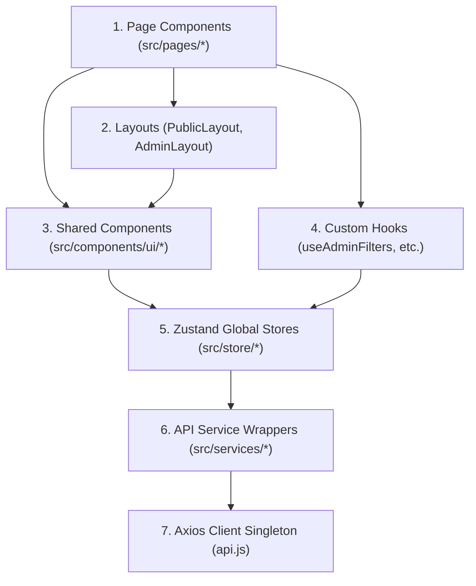

---

## 3. Authentication Flows

### Registration Lifecycle

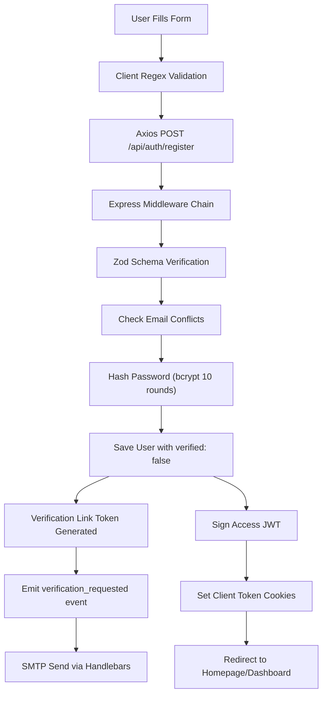

### Login, Sessions, and Lockout

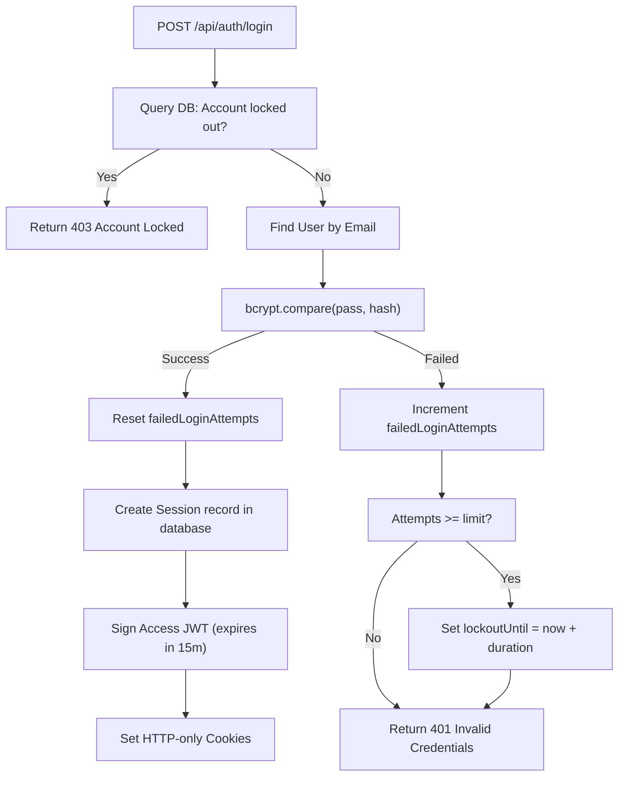

### Logout and Token Invalidation

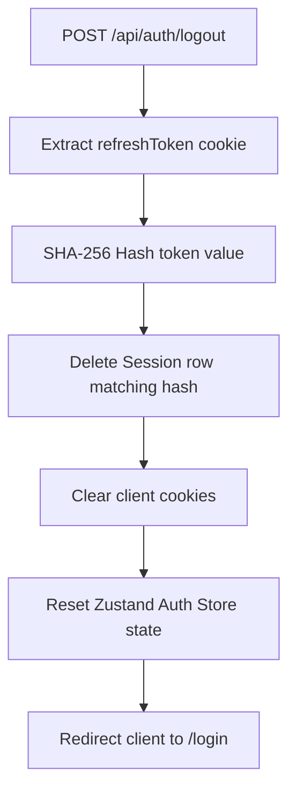

### Silent Refresh & 401 Retry Queue

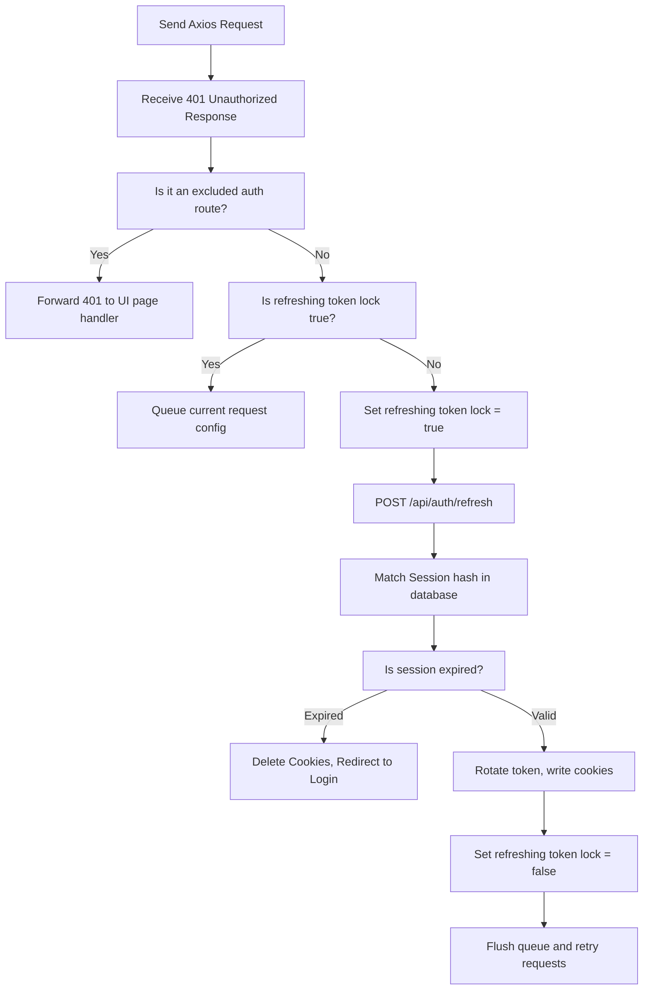

---

## 4. Product Catalog Flow

This flow maps search, filtering, pagination, and data loading for the shop's product listing.

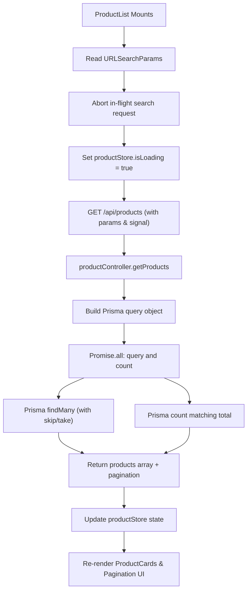

---

## 5. Wishlist Mutex Toggle Flow

This flowchart illustrates the optimistic toggle mechanism, request locking, and failure rollback loop.

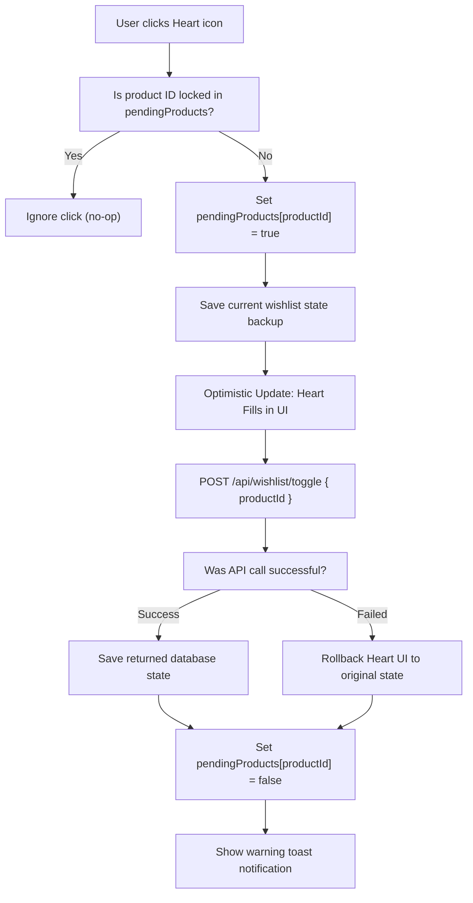

---

## 6. Cart Flow & Debounce Mechanism

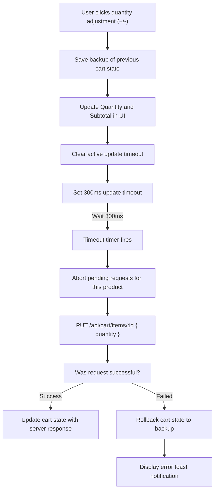

---

## 7. Checkout ACID Transaction Flow

This chart shows the steps of the order checkout process, which runs inside a database transaction to ensure data consistency.

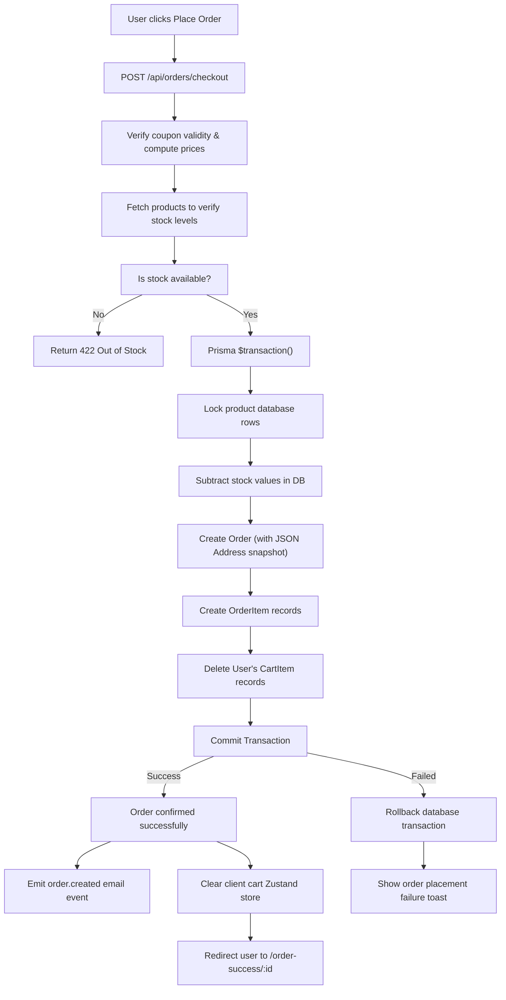

---

## 8. Customer Address Lifecycle

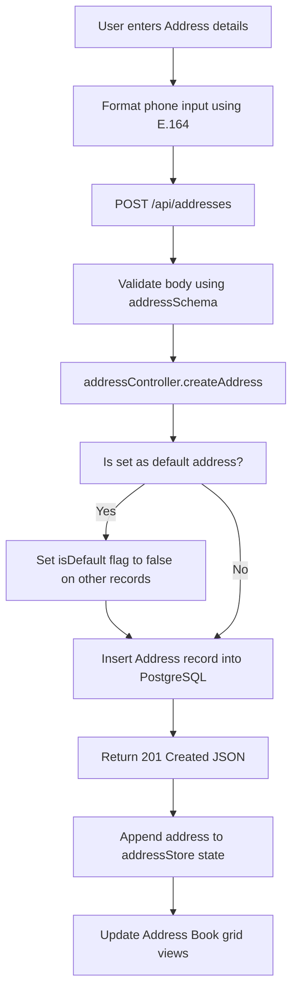

---

## 9. Admin Dashboard Analytics Caching Flow

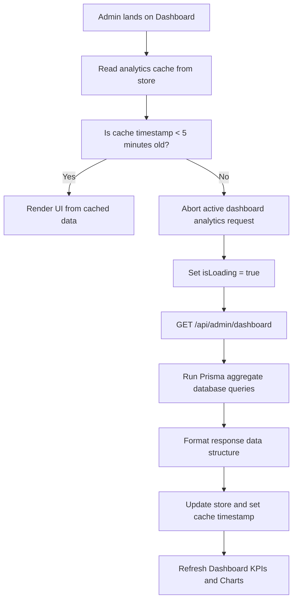

---

## 10. CRUD Flow (Product CRUD Lifecycle)

```mermaid
flowchart TD
    subgraph CreateFlow ["1. CREATE PRODUCT"]
        CA["Admin submits form"] --> CB["Zod Validation Check"]
        CB --> CC["POST /api/products"]
        CC --> CD["Insert record via Prisma"]
        CD --> CE["Append to productStore"]
        CE --> CF["Show creation success toast"]
    end

    subgraph ReadFlow ["2. READ PRODUCTS"]
        RA["Catalog Mounts"] --> RB["GET /api/products?page=1"]
        RB --> RC["Prisma findMany query"]
        RC --> RD["Set products in productStore"]
        RD --> RE["Render products table/grid"]
    end

    subgraph UpdateFlow ["3. UPDATE PRODUCT"]
        UA["Submit edit changes"] --> UB["PUT /api/products/:id"]
        UB --> UC["Update record via Prisma"]
        UC --> UD["Update item in productStore"]
        UD --> UE["Show edit success toast"]
    end

    subgraph DeleteFlow ["4. DELETE PRODUCT"]
        DA["Click delete button"] --> DB["Verify order history associations"]
        DB --> DC["DELETE /api/products/:id"]
        DC --> DD["Delete record via Prisma"]
        DD --> DE["Remove item from productStore"]
        DE --> DF["Show deletion success toast"]
    end
```

---

## 11. Backend Request Lifecycle

This diagram maps the path of an incoming HTTP request through the backend middlewares and routers.

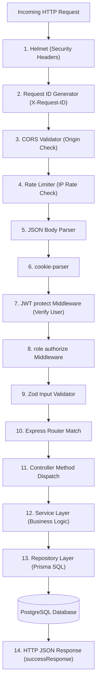

---

## 12. Middleware Stack Flow

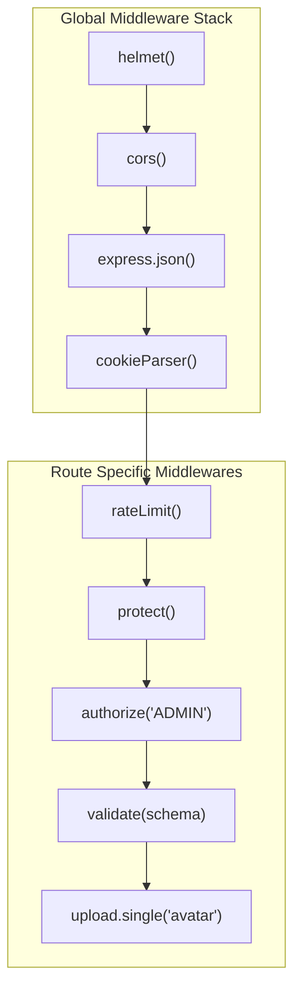

---

## 13. File Upload Flow (Cloudinary Stream)

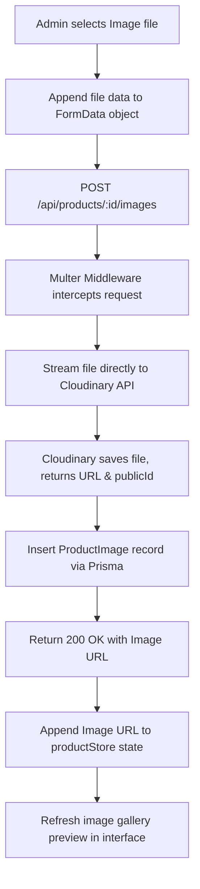

---

## 14. Query Flow (Prisma to SQL Translation)

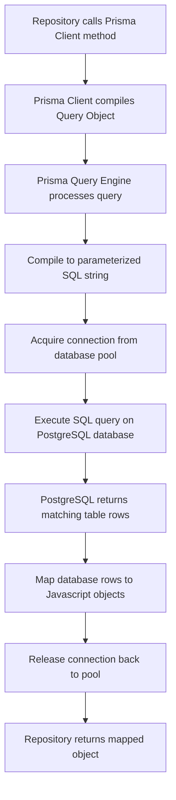

---

## 15. State Management Flow (Zustand Stores)

This flowchart illustrates how Zustand state changes trigger React component renders.

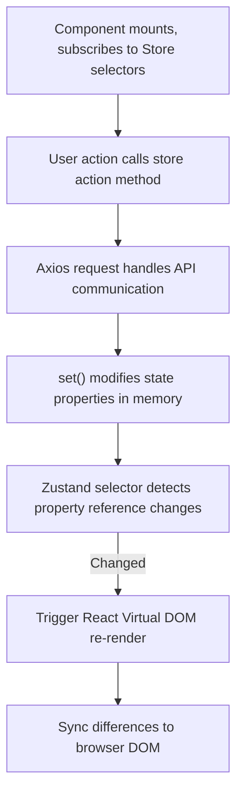

---

## 16. Sequence Diagrams

### 1. User Authentication (Login Flow)

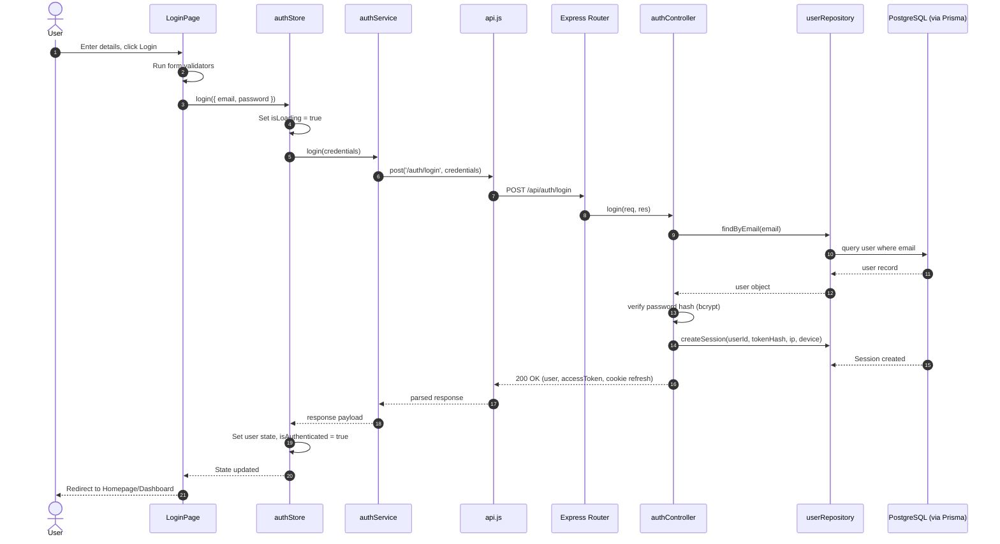

---

### 2. Wishlist Toggle Sequence Diagram

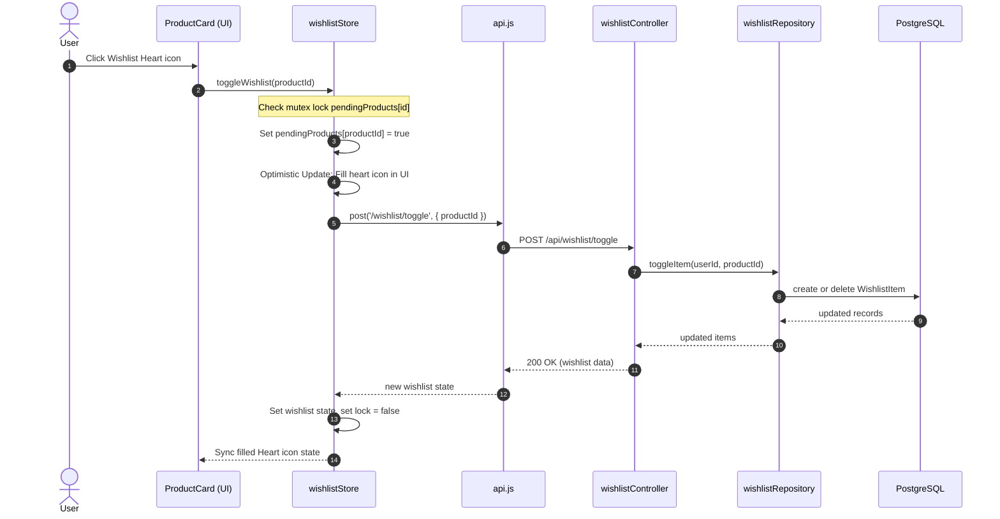

---

### 3. Cart Quantity Update Sequence Diagram

```mermaid
sequenceDiagram
    autonumber
    actor User
    participant View as CartPage (UI)
    participant Store as cartStore
    participant Axios as api.js
    participant CTRL as cartController
    participant Repo as cartRepository
    participant DB as PostgreSQL

    User->>View: Click Quantity Plus (+) button
    View->>Store: updateQuantity(productId, newQty)
    Store->>Store: Save backup of previous state
    Store->>Store: Optimistic Update: Update cart totals in UI
    Note over Store: Debounce: Clear previous timer, set 300ms delay
    Note over Store: Delay completes, timer fires
    Store->>Axios: PUT /cart/items/:id (with AbortController signal)
    Axios->>CTRL: PUT /api/cart/items/:id
    CTRL->>Repo: updateItemQuantity(userId, productId, qty)
    Repo->>DB: update quantity row
    DB-->>Repo: updated cart row
    Repo-->>CTRL: current cart items
    CTRL-->>Axios: 200 OK (updated cart data)
    Axios-->>Store: new cart state
    Store->>Store: Save verified items & clear loading state
    Store-->>View: State sync complete
```

---

### 4. Checkout Order Creation Sequence Diagram

```mermaid
sequenceDiagram
    autonumber
    actor User
    participant View as CheckoutPage (UI)
    participant Store as orderStore
    participant Axios as api.js
    participant CTRL as orderController
    participant Service as orderService
    participant Repo as orderRepository
    participant DB as PostgreSQL
    participant Email as EmailSubsystem

    User->>View: Click Place Order button
    View->>Store: createOrder(orderData)
    Store->>Axios: post('/orders/checkout', orderData)
    Axios->>CTRL: POST /api/orders/checkout
    CTRL->>Service: createOrder(userId, orderData)
    Service->>Repo: executeCheckoutTransaction(userId, data)
    Repo->>DB: Begin $transaction()
    Note over DB: Lock product rows & verify stock levels
    DB->>DB: Subtract product stock
    DB->>DB: Create Order & OrderItems
    DB->>DB: Delete CartItems
    Repo->>DB: Commit transaction
    DB-->>Repo: transaction committed
    Repo-->>Service: order details
    Service->>Email: Emit 'order.created' event
    Email-->>User: SMTP order confirmation email sent
    Service-->>CTRL: order object
    CTRL-->>Axios: 201 Created (order data)
    Axios-->>Store: save order
    Store->>Store: Clear client cart Zustand store
    Store-->>View: Redirect to Success Page
```

---

### 5. Admin Product CRUD Sequence Diagram (Creation)

```mermaid
sequenceDiagram
    autonumber
    actor Admin
    participant View as AdminProducts (UI)
    participant Store as productStore
    participant Axios as api.js
    participant CTRL as productController
    participant Service as productService
    participant Repo as productRepository
    participant DB as PostgreSQL

    Admin->>View: Submit new product form
    View->>Store: createProduct(productData)
    Store->>Axios: post('/products', productData)
    Axios->>CTRL: POST /api/products
    CTRL->>Service: createProduct(productData)
    Service->>Repo: create(productData)
    Repo->>DB: insert Product record
    DB-->>Repo: product record
    Repo-->>Service: product object
    Service-->>CTRL: product object
    CTRL-->>Axios: 201 Created (new product)
    Axios-->>Store: append new product to products array
    Store-->>View: UI table updates, display success toast
```

---

## 17. Master Architecture Subsystem Overview

This diagram represents how the front-end, state management, HTTP services, security middleware, and database layers integrate across the enterprise platform.

```mermaid
flowchart TB
    subgraph ClientLayer ["CLIENT SUBSYSTEM (React SPA)"]
        C1["Public Pages (Shop, Cart)"]
        C2["Admin Pages (Dashboard, Settings)"]
        C3["Shared UI Components (Inputs, Buttons)"]
        C4["Zustand State Stores"]
        C5["Axios Client Wrapper (api.js)"]
        
        C1 --> C3
        C2 --> C3
        C3 --> C4
        C4 --> C5
    end

    subgraph SecurityLayer ["SECURITY & NETWORK GATEWAY"]
        S1["CORS Origin Validator"]
        S2["Granular Rate Limiters"]
        S3["JWT Verification (protect)"]
        S4["Role Authorization (authorize)"]
        
        S1 --> S2
        S2 --> S3
        S3 --> S4
    end

    subgraph ServiceLayer ["BACKEND APPLICATION SUBSYSTEM (Express.js)"]
        B1["Express Router Handler"]
        B2["Zod Schema Validation Middleware"]
        B3["Controller Dispatch Layer"]
        B4["Business Logic Services"]
        B5["Repository Database Operations"]
        
        B1 --> B2
        B2 --> B3
        B3 --> B4
        B4 --> B5
    end

    subgraph ResourceLayer ["RESOURCE & STORAGE INTEGRATIONS"]
        DB[("PostgreSQL Database (Neon Serverless)")]
        IMG["Cloudinary CDN Image Storage"]
        MAIL["SMTP Nodemailer Services"]
    end

    C5 -->|REST HTTPS Requests| S1
    S4 --> B1
    B5 -->|Prisma Client SQL| DB
    B4 -->|File Stream Uploads| IMG
    B4 -->|EventEmitter emailEvents| MAIL
```
