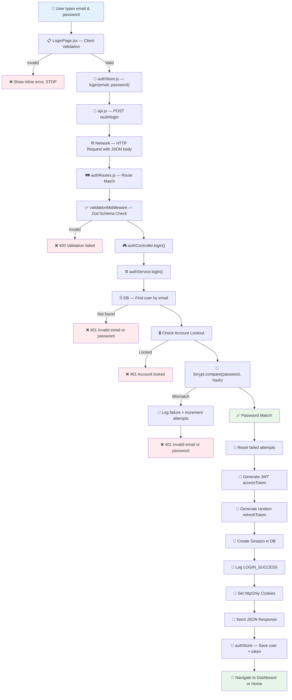

# Login Flow — Credentials Journey (Frontend → Backend → Response)

## Visual Overview



---

## Step-by-Step Credential Journey

### 🟢 STEP 1 — User Enters Credentials (Browser)
The user types their email and password into the login form.

**File:** [LoginPage.jsx](file:///c:/Users/Admin/Desktop/eCommerce/frontend/src/pages/auth/LoginPage.jsx#L11-L12)
```js
const [email, setEmail] = useState('');
const [password, setPassword] = useState('');
```
> At this point, credentials exist only as **plain text in React state** inside the browser's memory. Nothing has left the browser yet.

---

### 🟢 STEP 2 — Client-Side Validation (Browser)
When the user clicks "Sign In", `handleSubmit` runs.

**File:** [LoginPage.jsx](file:///c:/Users/Admin/Desktop/eCommerce/frontend/src/pages/auth/LoginPage.jsx#L46-L56)
```js
const emailValidation = sharedValidateEmail(email);       // checks format
const passwordValidation = sharedValidatePassword(password); // checks strength rules

if (emailValidation || passwordValidation) {
  setEmailError(emailValidation);
  setPasswordError(passwordValidation);
  return;  // ❌ STOP — never hits the network
}
```

**Validation rules** in [validators.js](file:///c:/Users/Admin/Desktop/eCommerce/frontend/src/utils/validators.js#L8-L22):
- Email: must match `^[^\s@]+@[^\s@]+\.[^\s@]+$`
- Password: min 8 chars, 1 uppercase, 1 lowercase, 1 number, 1 special character

> If validation fails, the credentials **never leave the browser**. Error messages appear inline.

---

### 🟢 STEP 3 — Zustand Store Sends to API (Browser)
Validation passed → `login(email, password)` is called on the Zustand store.

**File:** [authStore.js](file:///c:/Users/Admin/Desktop/eCommerce/frontend/src/store/authStore.js#L18-L31)
```js
login: async (email, password) => {
  set({ isLoading: true, error: null });
  try {
    const response = await api.post('/auth/login', { email, password });
    //                                               ^^^^^^^^^^^^^^^^
    //                     Credentials are now in the request body as JSON
    const { user, token } = response.data.data;
    set({ user, token, isAuthenticated: true });
    return true;
  } catch (error) {
    set({ error: parseError(error, 'Login failed') });
    return false;
  }
};
```

> The credentials are handed to `api.post()` as a plain JavaScript object `{ email, password }`.

---

### 🟢 STEP 4 — Axios Sends HTTP Request (Browser → Network)
The Axios instance serializes the credentials into JSON and sends them over the network.

**File:** [api.js](file:///c:/Users/Admin/Desktop/eCommerce/frontend/src/services/api.js#L4-L11)
```js
const api = axios.create({
  baseURL: import.meta.env.VITE_API_URL || '/api',
  withCredentials: true,    // ← sends cookies with every request
  headers: { 'Content-Type': 'application/json' },
});
```

**What the actual HTTP request looks like:**
```
POST /api/auth/login HTTP/1.1
Host: localhost:5000
Content-Type: application/json

{"email":"user@example.com","password":"MyP@ssw0rd!"}
```

> ⚠️ The password is sent as **plain text in the JSON body**. It is protected in transit by HTTPS in production. In local dev (`http://localhost`), it is unencrypted.

---

### 🟢 STEP 5 — Express Route Matching (Backend Server)
The request arrives at the Express server and matches a route.

**File:** [authRoutes.js](file:///c:/Users/Admin/Desktop/eCommerce/backend/src/routes/authRoutes.js#L16)
```js
router.post('/login', validate(loginSchema), authController.login);
//                    ^^^^^^^^^^^^^^^^^^^^   ^^^^^^^^^^^^^^^^^^^^^
//                    Middleware #1           Handler
```

> The route has **two stops**: first the validation middleware, then the controller.

---

### 🟢 STEP 6 — Zod Schema Validation (Backend Middleware)
Before the controller ever sees the credentials, Zod validates the request body.

**File:** [validationMiddleware.js](file:///c:/Users/Admin/Desktop/eCommerce/backend/src/middleware/validationMiddleware.js#L3-L17)
```js
export const validate = (schema) => (req, res, next) => {
  schema.parse({ body: req.body, query: req.query, params: req.params });
  next();  // ✅ Valid → continue to controller
};
```

**Schema:** [authValidation.js](file:///c:/Users/Admin/Desktop/eCommerce/backend/src/validations/authValidation.js#L19-L24)
```js
export const loginSchema = z.object({
  body: z.object({
    email: z.string().email('Invalid email format.'),
    password: passwordValidation,  // same strength rules as frontend
  }),
});
```

> If the email format is bad or the password doesn't meet strength rules → **400 Validation failed** is returned immediately. The controller is never called.

---

### 🟢 STEP 7 — Controller Extracts Request Info (Backend)
Validation passed → the controller runs.

**File:** [authController.js](file:///c:/Users/Admin/Desktop/eCommerce/backend/src/controllers/authController.js#L17-L24)
```js
async login(req, res, next) {
  const reqInfo = {
    ip: req.ip || req.connection.remoteAddress,  // user's IP address
    userAgent: req.headers['user-agent']          // browser fingerprint
  };
  const { user, accessToken, refreshToken, cookiesConfig } = 
    await authService.login(req.body, reqInfo);
  //                       ^^^^^^^^
  //            { email, password } passed to the service
}
```

> The controller adds the user's IP and browser info, then forwards everything to the service layer.

---

### 🟢 STEP 8 — Service: Find User by Email (Backend → Database)

**File:** [authService.js](file:///c:/Users/Admin/Desktop/eCommerce/backend/src/services/authService.js#L67-L74)
```js
const { email, password } = data;

const user = await userRepository.findByEmail(email);
if (!user) {
  throw new Error('Invalid email or password.');  // ❌ 401
}
```

> The email is used to query the database. If no user is found, a generic error is thrown (it does **NOT** say "email not found" — this prevents attackers from knowing which emails are registered).

---

### 🟢 STEP 9 — Service: Check Account Lockout (Backend)

**File:** [authService.js](file:///c:/Users/Admin/Desktop/eCommerce/backend/src/services/authService.js#L76-L81)
```js
const settings = await securitySettingsService.getSettings();

if (settings.accountLockoutEnabled && user.lockoutUntil && user.lockoutUntil > new Date()) {
  throw new Error(`Account locked until ${user.lockoutUntil.toLocaleTimeString()}`);
}
```

> If the account has too many previous failed attempts, it's locked temporarily. The password is **never even checked** in this case.

---

### 🟢 STEP 10 — Service: Compare Password with bcrypt (Backend — THE CRITICAL STEP)

**File:** [authService.js](file:///c:/Users/Admin/Desktop/eCommerce/backend/src/services/authService.js#L83-L100)
```js
const isMatch = await comparePassword(password, user.password);
```

**File:** [bcrypt.js](file:///c:/Users/Admin/Desktop/eCommerce/backend/src/utils/bcrypt.js#L9-L11)
```js
export const comparePassword = async (password, hash) => {
  return await bcrypt.compare(password, hash);
  //                 ^^^^^^^^  ^^^^^^^  ^^^^
  //                 library   plain    stored hash from DB
};
```

> **This is the only moment the plain-text password is compared.** bcrypt internally hashes the input with the same salt stored in the DB hash, then compares the results. The plain-text password is **never stored** anywhere.

**If password is WRONG:**
```js
if (!isMatch) {
  // Increment failed login attempts
  const attempts = user.failedLoginAttempts + 1;
  const updates = { failedLoginAttempts: attempts };
  if (attempts >= settings.failedLoginLimit) {
    updates.lockoutUntil = new Date(Date.now() + ms(settings.lockDuration));
  }
  await userRepository.update(user.id, updates);

  // Log the failure
  await prisma.securityLog.create({
    data: { userId: user.id, action: 'LOGIN_FAILED', ipAddress: reqInfo.ip }
  });

  throw new Error('Invalid email or password.');  // ❌ 401
}
```

---

### 🟢 STEP 11 — Service: Generate Tokens (Backend)
Password matched! Now the system creates authentication tokens.

**File:** [authService.js](file:///c:/Users/Admin/Desktop/eCommerce/backend/src/services/authService.js#L102-L140)

```js
// 1. Reset failed attempts
await userRepository.update(user.id, { failedLoginAttempts: 0, lockoutUntil: null });

// 2. Generate JWT access token
const accessToken = generateToken(
  { id: user.id, role: user.role, tokenVersion: user.tokenVersion },
  { expiresIn: settings.jwtExpiry }  // e.g. "15m"
);

// 3. Generate random refresh token
const refreshTokenPlain = crypto.randomBytes(64).toString('hex');
const refreshTokenHash = crypto.createHash('sha256').update(refreshTokenPlain).digest('hex');

// 4. Save session to database (only the HASH is stored, not the plain token)
await prisma.session.create({
  data: {
    userId: user.id,
    refreshTokenHash,
    device: deviceType, browser: browserName, operatingSystem: osName,
    ipAddress: reqInfo.ip,
    expiresAt: new Date(Date.now() + refreshMaxAge)
  }
});

// 5. Log success
await prisma.securityLog.create({
  data: { userId: user.id, action: 'LOGIN_SUCCESS', ipAddress: reqInfo.ip }
});
```

**JWT payload** (inside the access token):
```json
{ "id": "user-uuid", "role": "USER", "tokenVersion": 1, "iat": 1719999999, "exp": 1720000899 }
```

---

### 🟢 STEP 12 — Controller: Set Cookies & Send Response (Backend → Network)

**File:** [authController.js](file:///c:/Users/Admin/Desktop/eCommerce/backend/src/controllers/authController.js#L26-L41)
```js
// Set httpOnly cookies (browser can't access these via JavaScript)
res.cookie('accessToken', accessToken, {
  httpOnly: true,           // ← JS can't read this cookie
  secure: process.env.NODE_ENV === 'production',  // ← HTTPS only in prod
  sameSite: 'Lax',          // ← CSRF protection
  maxAge: cookiesConfig.accessMaxAge
});

res.cookie('refreshToken', refreshToken, {
  httpOnly: true, secure: ..., sameSite: 'Lax',
  maxAge: cookiesConfig.refreshMaxAge
});

// Also send token in the JSON body (for Zustand to persist)
return successResponse(res, 'Login successful', { user, token: accessToken }, 200);
```

**What the HTTP response looks like:**
```
HTTP/1.1 200 OK
Set-Cookie: accessToken=eyJhbG...; HttpOnly; Path=/; SameSite=Lax
Set-Cookie: refreshToken=a3f9b2...; HttpOnly; Path=/; SameSite=Lax
Content-Type: application/json

{
  "success": true,
  "message": "Login successful",
  "data": {
    "user": { "id": "...", "name": "Priyal", "email": "...", "role": "USER" },
    "token": "eyJhbGciOiJIUzI1NiIs..."
  }
}
```

> The credentials are **gone** at this point. Only tokens remain. The password was **never stored, logged, or returned**.

---

### 🟢 STEP 13 — Zustand Store Saves State (Browser)

**File:** [authStore.js](file:///c:/Users/Admin/Desktop/eCommerce/frontend/src/store/authStore.js#L22-L24)
```js
const { user, token } = response.data.data;
set({ user, token, isAuthenticated: true });
```

This is persisted to `localStorage` under the key `auth-storage` by Zustand's `persist` middleware:
```json
{
  "state": {
    "user": { "id": "...", "name": "Priyal", "role": "USER" },
    "token": "eyJhbGciOi...",
    "isAuthenticated": true
  }
}
```

---

### 🟢 STEP 14 — Redirect Based on Role (Browser)

**File:** [LoginPage.jsx](file:///c:/Users/Admin/Desktop/eCommerce/frontend/src/pages/auth/LoginPage.jsx#L62-L73)
```js
if (success) {
  const { user } = useAuthStore.getState();
  if (user?.role === 'ADMIN') {
    navigate('/admin/dashboard');  // Admin goes to admin panel
  } else {
    navigate(from || '/');         // Regular user goes to home (or where they came from)
  }
}
```

---

## Summary Table

| Step | Where | What happens to the password |
|------|-------|------------------------------|
| 1 | Browser (React state) | Plain text in memory |
| 2 | Browser (validators.js) | Checked for format/strength |
| 3 | Browser (authStore.js) | Passed to `api.post()` |
| 4 | Network (HTTP) | Sent as JSON in request body |
| 5 | Backend (Express router) | Route matched |
| 6 | Backend (Zod middleware) | Format re-validated |
| 7 | Backend (controller) | Forwarded to service |
| 8 | Backend (service) | Email used to find user |
| 9 | Backend (service) | Lockout check (password not touched) |
| **10** | **Backend (bcrypt)** | **Compared against stored hash — then DISCARDED** |
| 11 | Backend (service) | Tokens generated (password gone) |
| 12 | Backend (controller) | Tokens sent via cookies + JSON |
| 13 | Browser (Zustand) | Token saved, password forgotten |
| 14 | Browser (React Router) | User redirected |

> [!IMPORTANT]
> The plain-text password only exists momentarily at **Step 10** for the bcrypt comparison. It is never written to the database, never logged, and never included in the response.
