# Enterprise Authentication & Security Implementation Documentation
**LuxeHome eCommerce Platform**

---

## Table of Contents
1. [Executive Summary for Management](#1-executive-summary-for-management)
2. [API & Request Lifecycle Architecture](#2-api--request-lifecycle-architecture)
3. [Authentication Design & Flows](#3-authentication-design--flows)
   - [Registration Flow](#registration-flow)
   - [Login Flow & Account Lockout Policy](#login-flow--account-lockout-policy)
   - [Logout Flow](#logout-flow)
   - [Forgot Password Flow](#forgot-password-flow)
   - [Reset Password Flow](#reset-password-flow)
   - [Email Verification Flow](#email-verification-flow)
   - [Token Refresh & Rotation Flow](#token-refresh--rotation-flow)
   - [Session Validation & Revocation](#session-validation--revocation)
4. [Authorization Model & RBAC](#4-authorization-model--rbac)
   - [Role-Based Access Control Matrix](#role-based-access-control-matrix)
   - [Route Protection Matrix](#route-protection-matrix)
5. [Backend Security Architecture & Controls](#5-backend-security-architecture--controls)
6. [Database & Prisma Security](#6-database--prisma-security)
7. [Encryption & Secrets Management](#7-encryption--secrets-management)
8. [Frontend Security Architecture](#8-frontend-security-architecture)
9. [Admin Portal Protection](#9-admin-portal-protection)
10. [Architecture Flowcharts (Mermaid)](#10-architecture-flowcharts-mermaid)
11. [Sequence Diagrams (Mermaid)](#11-sequence-diagrams-mermaid)
12. [Project Structure Mapping](#12-project-structure-mapping)

---

## 1. Executive Summary for Management

This report provides a detailed, code-level documentation of the authentication, authorization, and core security architectures implemented in the **LuxeHome** eCommerce platform. 

The security strategy of the platform is designed with a defense-in-depth approach, ensuring data protection, secure session management, and robust access controls at both frontend and backend layers.

### Key Security Achievements
- **Dual-Token Cookie Session Model**: The platform uses a cookie-based JWT architecture for session management. Access and Refresh tokens are stored in `HttpOnly`, `Secure` (in production), and `SameSite=Lax` cookies, preventing Cross-Site Scripting (XSS) access to tokens.
- **Cryptographic Token Rotation & Invalidation**: Refresh tokens are cryptographically generated (64-byte random hex), hashed with SHA-256 for database storage, and rotated on every refresh. Active sessions are validated via a database-stored `Session` model. A user-specific `tokenVersion` counter is implemented to facilitate immediate global session revocation (e.g., upon password reset or admin-forced logout).
- **Secure Password Policies & Hashing**: Passwords are never stored in plain text. Hashing is performed using `bcrypt` with 10 salt rounds. Robust password validation rules are enforced at both frontend and backend (Zod validations) requiring a minimum length of 8 characters, uppercase, lowercase, numbers, and special characters.
- **Account Lockout Policy**: Login routes protect accounts against brute-force attacks by locking out users after 5 failed login attempts for a duration of 15 minutes (configured in DB system settings).
- **Secrets Encryption at Rest**: Sensitive integration credentials (e.g., Stripe secret keys, Razorpay secrets, SMTP passwords) are stored encrypted in the PostgreSQL database using symmetric `AES-256-GCM` encryption.
- **Granular Rate Limiting**: The platform establishes route-specific rate limits (Auth, Admin, Global, and Read) using `express-rate-limit` to prevent Denial of Service (DoS) and brute-force attempts.
- **Secure Error Handling & Prevention of Information Leaks**: The system handles errors securely via `errorMiddleware.js`, logging complete stack traces and request metadata to the server console while sending sanitized, generic responses to the client, specifically blocking database internals or ORM (Prisma) keywords from leaking.
- **PCI DSS-Compliant Checkout**: No credit card or CVV details are ever stored in the database. Card checksums are validated in-memory using the Luhn algorithm, and only safe payment metadata (e.g., last 4 digits, card brand, transaction reference) is recorded.
- **GDPR Cookie Consent**: A complete consent architecture allows users to choose preferences for Necessary, Analytics, Functional, and Marketing cookies, persists settings in `localStorage` and syncs them to the backend database.

---

## 2. API & Request Lifecycle Architecture

The LuxeHome platform enforces security checks at every level of the request lifecycle. The request flow from the browser to the database is organized hierarchically:

```
[Frontend Client]
       │ (Zustand Auth Store / localStorage token fallback)
       ▼
[Axios Interceptors] (Attaches Bearer JWT token, manages automatic token refresh queues)
       │
       ▼
[API Gateway / Routing Layer] (Routes defined in Express app)
       │
       ▼
[Granular Rate Limiters] (Checks request counts per IP/route)
       │
       ▼
[Security Middlewares] (Helmet HTTP Headers, CORS configuration, cookieParser)
       │
       ▼
[Authentication Middleware] (protects endpoint: parses and decodes JWT, verifies tokenVersion)
       │
       ▼
[Authorization Middleware] (authorizes role: checks roles CUSTOMER, ADMIN, SUPER_ADMIN)
       │
       ▼
[Request Schema Validation] (Zod parser validates body, params, query parameters)
       │
       ▼
[Controller Layer] (Orchestrates response, handles payment checksums/validations)
       │
       ▼
[Service Layer] (Implements business logic, triggers encryption services, emits events)
       │
       ▼
[Repository Layer] (Coordinates data queries and database transactions)
       │
       ▼
[Prisma Client ORM] (Executes parameterized queries and prepared statements)
       │
       ▼
[PostgreSQL Database] (Stores data securely, handles schema restrictions)
```

---

## 3. Authentication Design & Flows

Authentication logic is centralized in the backend inside [authController.js](file:///c:/Users/Admin/Desktop/eCommerce/backend/src/controllers/authController.js), [authService.js](file:///c:/Users/Admin/Desktop/eCommerce/backend/src/services/authService.js), and [authMiddleware.js](file:///c:/Users/Admin/Desktop/eCommerce/backend/src/middleware/authMiddleware.js).

### Registration Flow
1. **Request Reception**: The frontend POSTs payload containing `name`, `email`, `password`, and optional `phone` to `/api/auth/register`.
2. **Schema Validation**: The request is intercepted by the Zod schema validator `registerSchema` defined in [authValidation.js](file:///c:/Users/Admin/Desktop/eCommerce/backend/src/validations/authValidation.js). This checks email format and runs the password complexity regex.
3. **Uniqueness Check**: The database is queried via `userRepository.findByEmail(email)`. If the user exists, a 400 response is returned (`"User already exists"`).
4. **Password Hashing**: The password is hashed using `bcrypt` (10 salt rounds) in [bcrypt.js](file:///c:/Users/Admin/Desktop/eCommerce/backend/src/utils/bcrypt.js).
5. **Token Generation**: Generates a 32-byte cryptographically secure random email verification token (`verificationToken`) and sets expiry to `24 hours` from creation.
6. **User Creation**: Persists user record to the `User` model with `isEmailVerified: false`.
7. **Email Emission**: Emits `user.registered` and `user.verification_requested` events asynchronously to send out verification emails via SMTP.
8. **JWT Access Token**: Generates an initial JWT access token containing the payload `{ id: user.id, role: user.role, tokenVersion: user.tokenVersion }`. Returns the user object and token in response (201 Created).

### Login Flow & Account Lockout Policy
1. **Request Reception**: POST `/api/auth/login` containing `email` and `password`. Validated by `loginSchema`.
2. **User Lookup**: Retrieves user by email. If not found, returns `401 Unauthorized` with a generic message: `"Invalid email or password."` to prevent user enumeration.
3. **Lockout Check**: If `accountLockoutEnabled` is active in system settings, checks if `user.lockoutUntil` is in the future. If so, throws an error: `"Account locked until [time]. Please try again later."`
4. **Password Verification**: Compares submitted password with database hash using `bcrypt.compare`.
   - **On Match**: Resets `failedLoginAttempts` to 0 and `lockoutUntil` to null.
   - **On Mismatch**: Increments `failedLoginAttempts`. If attempts exceed `failedLoginLimit` (default: 5), calculates lockout expiration using `lockDuration` (default: 15 minutes) and writes `lockoutUntil` to the database. Creates a `LOGIN_FAILED` entry in the `SecurityLog` table.
5. **Session Creation**:
   - Parses the request User Agent (UA) using `UAParser` to log browser, operating system, and device type.
   - Generates a JWT access token using settings-defined expiry.
   - Generates a plain-text 64-byte random hex refresh token. Hashes it with SHA-256 for secure database storage.
   - Inserts session into `Session` table containing the hashed token, user ID, client IP address, parsed User Agent details, and expiration date.
6. **Dual Cookies Setup**: Sets two HTTP response headers:
   - `accessToken` cookie: HttpOnly, SameSite='Lax', secure in production, maxAge matches JWT expiry.
   - `refreshToken` cookie: HttpOnly, SameSite='Lax', secure in production, maxAge matches refresh token expiry.
7. **Security Log**: Creates a `LOGIN_SUCCESS` entry in the `SecurityLog` table.

### Logout Flow
1. **Request Reception**: POST `/api/auth/logout`. Route requires authentication via `protect` middleware.
2. **Database Invalidation**: If the client provides a `refreshToken` cookie, the system calculates its SHA-256 hash, looks up the session in the database, and deletes it. Writes a `LOGOUT` entry to the `SecurityLog` table.
3. **Cookie Deletion**: Clears `accessToken` and `refreshToken` cookies on the client browser.

### Forgot Password Flow
1. **Request Reception**: POST `/api/auth/forgot-password` with `email` validated via `forgotPasswordSchema`.
2. **Enumeration Protection**: Searches database for the user. If the user does not exist, the API returns a success message: `"If your email is registered, a password reset link has been sent."` to prevent attackers from discovering registered emails.
3. **Token Creation**: Generates a 32-byte cryptographically secure random reset token, setting expiration to 15 minutes. Updates the user's `resetPasswordToken` and `resetPasswordExpires` fields.
4. **Link Delivery**: Sends email asynchronously containing the tokenized link.

### Reset Password Flow
1. **Request Reception**: POST `/api/auth/reset-password` containing `token` and `password` validated via Zod.
2. **Token Verification**: Queries user where `resetPasswordToken` matches the token and `resetPasswordExpires` is greater than the current date. Throws if invalid or expired.
3. **Password Update**: Hashes the new password via `bcrypt`. Saves it to the database, nullifies the reset token fields, updates `passwordUpdatedAt`, and **increments `tokenVersion` by 1**.
4. **JWT Invalidation**: Due to `tokenVersion` incrementation, any existing JWT access tokens generated prior to the reset immediately fail authentication checks.

### Email Verification Flow
1. **Request Reception**: POST `/api/auth/verify-email` with token.
2. **Verification Check**: Finds user where `verificationToken` matches and `verificationExpires` is in the future.
3. **Status Update**: Sets `isEmailVerified: true` and nullifies verification token fields.

### Token Refresh & Rotation Flow
The refresh flow provides seamless token rotation to keep users logged in securely:
1. **Trigger**: Axios interceptor detects a `401 Unauthorized` response on a protected API call and triggers POST `/api/auth/refresh`.
2. **Cookie Inspection**: Reads `refreshToken` from the browser request cookie.
3. **Hash Matching**: Hashes the plain-text refresh token using SHA-256 and queries the database `Session` table where `refreshTokenHash` matches and `isActive` is true.
4. **Validation**: Checks if `session.expiresAt` is in the future. If expired, deletes the session, clears browser cookies, and throws an error forcing a redirect to `/login`.
5. **Rotation**:
   - Generates a new 64-byte random hex refresh token.
   - Hashes it and updates the current session record's `refreshTokenHash`, updating `lastActivity` and resetting `expiresAt`.
   - Generates a new JWT access token with user details.
6. **Response Headers**: Returns new access and refresh tokens in HttpOnly cookies, and logs a `TOKEN_REFRESHED` event.

### Session Validation & Revocation
The [authMiddleware.js](file:///c:/Users/Admin/Desktop/eCommerce/backend/src/middleware/authMiddleware.js) file protects access to resources:
1. **Extraction**: Checks `req.cookies.accessToken` or extracts `Bearer [token]` from the `Authorization` header.
2. **Verification**: Verifies JWT signature using `process.env.JWT_SECRET`.
3. **Database Check**: Queries database user using decoded ID, fetching `id`, `role`, and `tokenVersion`.
4. **Token Version Check**: Compares `decoded.tokenVersion` with the database `user.tokenVersion`. If they are not equal (mismatch due to password change or admin forced log out), rejects the request with a `401 Session expired or invalidated` message.

---

## 4. Authorization Model & RBAC

The platform implements a Role-Based Access Control (RBAC) model governed by the `Role` enum in [schema.prisma](file:///c:/Users/Admin/Desktop/eCommerce/backend/prisma/schema.prisma):
- `CUSTOMER`
- `ADMIN`
- `SUPER_ADMIN`

Role authorization checks are enforced by the `authorize(...roles)` middleware in [roleMiddleware.js](file:///c:/Users/Admin/Desktop/eCommerce/backend/src/middleware/roleMiddleware.js):
- The middleware supports **implicit role inheritance**: if the allowed roles array includes `'ADMIN'`, it automatically pushes `'SUPER_ADMIN'` as an authorized role.
- If the authenticated user's role is not included in the allowed roles, a `403 Forbidden` response is returned.

### Role-Based Access Control Matrix

| Action / Resource | Guest | Customer | Admin | Super Admin | Implemented Via |
| :--- | :---: | :---: | :---: | :---: | :--- |
| View Products / Categories | ✅ | ✅ | ✅ | ✅ | Public Routes in [productRoutes.js](file:///c:/Users/Admin/Desktop/eCommerce/backend/src/routes/productRoutes.js) |
| Manage Cart / Wishlist | ❌ | ✅ | ✅ | ✅ | `protect` in [cartRoutes.js](file:///c:/Users/Admin/Desktop/eCommerce/backend/src/routes/cartRoutes.js), [wishlistRoutes.js](file:///c:/Users/Admin/Desktop/eCommerce/backend/src/routes/wishlistRoutes.js) |
| Submit Order / Checkout | ❌ | ✅ | ❌ | ❌ | `protect` + card/address checks in [orderRoutes.js](file:///c:/Users/Admin/Desktop/eCommerce/backend/src/routes/orderRoutes.js) |
| View Personal Profile / Orders | ❌ | ✅ | ✅ | ✅ | `protect` in [userRoutes.js](file:///c:/Users/Admin/Desktop/eCommerce/backend/src/routes/userRoutes.js) |
| Edit Personal Profile | ❌ | ✅ | ✅ | ✅ | `protect` in [userRoutes.js](file:///c:/Users/Admin/Desktop/eCommerce/backend/src/routes/userRoutes.js) |
| Manage Product Catalog | ❌ | ❌ | ✅ | ✅ | `protect`, `authorize('ADMIN')` in [productRoutes.js](file:///c:/Users/Admin/Desktop/eCommerce/backend/src/routes/productRoutes.js) |
| View Admin Dashboard / Analytics | ❌ | ❌ | ✅ | ✅ | `protect`, `authorize('ADMIN')` in [adminRoutes.js](file:///c:/Users/Admin/Desktop/eCommerce/backend/src/routes/adminRoutes.js) |
| Manage Banners / Branding | ❌ | ❌ | ✅ | ✅ | `protect`, `authorize('ADMIN')` in [adminRoutes.js](file:///c:/Users/Admin/Desktop/eCommerce/backend/src/routes/adminRoutes.js) |
| Manage Store/Shipping/SMTP Settings | ❌ | ❌ | ✅ | ✅ | `protect`, `authorize('ADMIN', 'SUPER_ADMIN')` in [settingsRoutes.js](file:///c:/Users/Admin/Desktop/eCommerce/backend/src/routes/settingsRoutes.js) |
| View Security Settings / Sessions | ❌ | ❌ | ✅ | ✅ | `protect`, `authorize('ADMIN', 'SUPER_ADMIN')` in [securityAdminRoutes.js](file:///c:/Users/Admin/Desktop/eCommerce/backend/src/routes/securityAdminRoutes.js) |
| Force Global User Logout | ❌ | ❌ | ✅ | ✅ | `protect`, `authorize('ADMIN', 'SUPER_ADMIN')` in [securityAdminRoutes.js](file:///c:/Users/Admin/Desktop/eCommerce/backend/src/routes/securityAdminRoutes.js) |

*Note: In the route [CustomerProtectedRoute.jsx](file:///c:/Users/Admin/Desktop/eCommerce/frontend/src/components/layout/CustomerProtectedRoute.jsx), if an authenticated user with role `'ADMIN'` attempts to access customer storefront protected pages (e.g., checkout), the system automatically redirects them to `/admin/dashboard`. This prevents admins from accidentally engaging in store transactional activities restricted to customers.*

### Route Protection Matrix

| Route Endpoint | HTTP Method | Access Level | Middlewares Executed |
| :--- | :---: | :---: | :--- |
| `/api/auth/register` | POST | Guest | `authLimiter`, `validate(registerSchema)` |
| `/api/auth/login` | POST | Guest | `authLimiter`, `validate(loginSchema)` |
| `/api/auth/refresh` | POST | Guest / Auth | `authLimiter` |
| `/api/auth/logout` | POST | Authenticated | `authLimiter`, `protect` |
| `/api/auth/me` | GET | Authenticated | `protect` |
| `/api/auth/password` | PUT | Authenticated | `protect` |
| `/api/products` | GET | Public | `readLimiter` |
| `/api/products/:id` | GET | Public | `readLimiter` |
| `/api/products` | POST | Admin | `protect`, `authorize('ADMIN')`, `validate(productSchema)` |
| `/api/products/:id` | PUT | Admin | `protect`, `authorize('ADMIN')`, `validate(productSchema)` |
| `/api/products/:id` | DELETE | Admin | `protect`, `authorize('ADMIN')` |
| `/api/products/import-preview` | POST | Admin | `protect`, `authorize('ADMIN')`, `uploadDoc.single('file')` |
| `/api/cart/*` | Any | Authenticated | `globalLimiter`, `protect` |
| `/api/wishlist/*` | Any | Authenticated | `globalLimiter`, `protect` |
| `/api/orders/checkout` | POST | Customer | `globalLimiter`, `protect` |
| `/api/orders` | GET | Authenticated | `globalLimiter`, `protect` |
| `/api/admin/*` | Any | Admin | `adminLimiter`, `protect`, `router.use(authorize('ADMIN'))` |
| `/api/admin/security/*` | Any | Admin / Super Admin | `adminLimiter`, `protect`, `router.use(authorize('ADMIN', 'SUPER_ADMIN'))` |
| `/api/settings/*` | Any | Admin / Super Admin | `readLimiter` / `protect`, `router.use(authorize('ADMIN', 'SUPER_ADMIN'))` |

---

## 5. Backend Security Architecture & Controls

Core security mechanisms are set up globally inside [app.js](file:///c:/Users/Admin/Desktop/eCommerce/backend/src/app.js) and configured dynamically:

### Express Middleware Hardening
- **Helmet.js**: Implements security headers natively. Helmet sets key headers to protect against common web threats:
  - `Content-Security-Policy` (CSP)
  - `X-Frame-Options` (denies clickjacking)
  - `X-Content-Type-Options` (prevents MIME sniffing)
  - `Strict-Transport-Security` (HSTS enforcement)
- **CORS Management**: Cross-Origin Resource Sharing is configured dynamically. Origins are read from `process.env.FRONTEND_URL` (split by comma to support multiple origins) or fallback to `http://localhost:5173`. `credentials: true` allows secure cookie exchange.
- **Compression**: Optimized using gzip via `compression` middleware with support for exclusion flags (e.g. requests with header `x-no-compression` are skipped).
- **Cookie Parser**: Standard parser used to read incoming cookie-signed headers for auth tokens.

### Granular Rate Limiting
Enforced in [rateLimiter.js](file:///c:/Users/Admin/Desktop/eCommerce/backend/src/middleware/rateLimiter.js):
- **`globalLimiter`**: 500 requests per 15 minutes. Used for standard cart and checkout APIs.
- **`authLimiter`**: 20 requests per 15 minutes. Enforces strict constraints on registration, login, forgot/reset password endpoints to block brute-forcing.
- **`adminLimiter`**: 2000 requests per 15 minutes. Allows higher request volumes for administrative dashboards.
- **`readLimiter`**: 1000 requests per 15 minutes. Protects read-only endpoints (e.g. products, banners).

### Request ID Injection
A custom middleware generates a unique Request ID for each incoming request:
```javascript
app.use((req, res, next) => {
  req.id = req.headers['x-request-id'] || crypto.randomUUID();
  res.setHeader('X-Request-ID', req.id);
  next();
});
```
This ID is attached to the HTTP response header `X-Request-ID` and logged on any server-side exceptions, facilitating debugging.

---

## 6. Database & Prisma Security

The database layer relies on PostgreSQL managed via Prisma ORM:

### SQL Injection Protection
By utilizing Prisma Client, all queries are parameterized by default:
- Queries such as `prisma.user.findUnique({ where: { id } })` compile to parameterized SQL statements. Values are sent as separate parameters rather than being concatenated directly into the query string, eliminating classic SQL injection.
- Review of the codebase reveals **no usage of raw SQL queries** (e.g., `prisma.$queryRaw` is not used).

### Safe Pagination and Filtering
Data querying utilizes offset pagination helper methods in [paginationHelper.js](file:///c:/Users/Admin/Desktop/eCommerce/backend/src/utils/paginationHelper.js), converting user inputs into integers and constraining pagination bounds:
- Page index: clamped to minimum `1` and verified to not exceed calculated total page counts.
- Page limit: clamped to `limit` variables, with ceiling limits (e.g., maximum `100` items per request) to prevent database memory exhaustion (Denial of Service).

### Database Model Security Fields
The database schema in [schema.prisma](file:///c:/Users/Admin/Desktop/eCommerce/backend/prisma/schema.prisma) defines:
- `failedLoginAttempts` & `lockoutUntil` for brute-force prevention.
- `tokenVersion` for cryptographic token revocation.
- `passwordUpdatedAt` to log password modification timelines.
- Cascade deletions for dependent tables (e.g. `Session`, `CookieConsent` are deleted when `User` is deleted) preventing orphaned rows.

---

## 7. Encryption & Secrets Management

The platform utilizes industry-standard encryption practices to protect sensitive variables:

### Hashing Algorithm (Password Storage)
- **Library**: `bcrypt` (compiled natively in [bcrypt.js](file:///c:/Users/Admin/Desktop/eCommerce/backend/src/utils/bcrypt.js)).
- **Strength**: 10 salt rounds (`SALT_ROUNDS = 10`), generating strong, unique, salted hashes.
- **Verification**: `bcrypt.compare` checks passwords. In-memory comparison prevents password leakage.

### Symmetric Database Encryption (Secrets at Rest)
Sensitive system configuration values are encrypted at rest in the PostgreSQL database using [crypto.js](file:///c:/Users/Admin/Desktop/eCommerce/backend/src/utils/crypto.js) or [aes256.js](file:///c:/Users/Admin/Desktop/eCommerce/backend/src/utils/aes256.js):
- **Algorithm**: `aes-256-gcm` (AES with Galois/Counter Mode).
- **Key Derivation**: [aes256.js](file:///c:/Users/Admin/Desktop/eCommerce/backend/src/utils/aes256.js) derives a 32-byte key from `process.env.AES_SECRET_KEY` using PBKDF2 with a random 64-byte salt, sha512 algorithm, and 100,000 iterations.
- **Encryption Format**: Combines Salt, Initialization Vector (IV), Auth Tag, and Ciphertext into a base64 string:
  `Buffer.concat([salt, iv, tag, ciphertext]).toString('base64')`
- **Decryption**: Decodes the base64 string, derives the identical key using the extracted salt, verifies the authentication tag (GCM integrity check), and decrypts the text.
- **Fields Encrypted**:
  - `stripeSecretKey` (Payment settings)
  - `razorpayKeySecret` (Payment settings)
  - SMTP `password` (SMTP settings)

### Secret Management
- Database URL, Cloudinary credentials, `JWT_SECRET`, and `AES_SECRET_KEY` are retrieved strictly from environment variables (`.env`) and never hardcoded in files.
- Sample variables are documented in [env.example](file:///c:/Users/Admin/Desktop/eCommerce/backend/.env.example).

---

## 8. Frontend Security Architecture

Frontend security is managed via Zustand state controls and Axios middleware inside `/frontend/src`:

### State Management & JWT Storage
- **Store**: Enforced by Zustand store in [authStore.js](file:///c:/Users/Admin/Desktop/eCommerce/frontend/src/store/authStore.js).
- **Storage Strategy**: Access tokens are stored in the Zustand store memory and persisted in `localStorage` under `auth-storage` using the Zustand `persist` middleware.
- **Cookie Usage**: Because Axios uses `withCredentials: true`, cookies are stored and sent by the browser. 

### Axios Interceptors (Request/Response)
Implemented in [api.js](file:///c:/Users/Admin/Desktop/eCommerce/frontend/src/services/api.js):
- **Request Headers**: Automatically retrieves the access token from `localStorage` (`auth-storage` or legacy fallback) and injects it as `Authorization: Bearer [token]`.
- **Automated Refresh on 401**:
  - If a non-auth request fails with a `401 Unauthorized` response, the interceptor intercepts the error.
  - If a refresh token rotation is not already in progress, it sets `isRefreshing = true` and triggers a POST to `/api/auth/refresh`.
  - Any concurrent API requests that fail with 401 during refresh are queued in `failedQueue`.
  - If the refresh succeeds, the interceptor re-executes the original request and resolves all queued requests.
  - If the refresh fails, it clears all auth storage fields (`localStorage.removeItem('auth-storage')`, `localStorage.removeItem('token')`) and redirects the user to `/login`.
  - Auth routes (e.g. `/auth/login`, `/auth/register`) bypass refresh interception.

### Route Guards
- **CustomerProtectedRoute**: Redirects unauthenticated users to `/login` with location history, and redirects admins to `/admin/dashboard` to prevent cross-profile navigation.
- **GuestProtectedRoute**: Prevents logged-in users from accessing registration/login paths.
- **AdminLayout**: Prevents non-admins from loading admin portal assets and paths, enforcing `user?.role === 'ADMIN'`.

### GDPR Cookie Consent Banner & Storage
- **Consent Banner**: Prompts users upon initial visit.
- **Preference Configurations**: Necessary (mandatory), Analytics, Functional, and Marketing.
- **Storage**: Consents are recorded in local storage under key `ecommerce_cookie_consent` and sent to the database via API endpoints `/users/cookie-consent`.

---

## 9. Admin Portal Protection

The Admin interface enforces separate route-level validation checks:

### Audit Logging
Administrative operations that modify configurations (e.g. updating platform SMTP settings or branding elements) write records to the `AuditLog` table using [auditLogger.js](file:///c:/Users/Admin/Desktop/eCommerce/backend/src/services/auditLogger.js). This captures the admin's name, affected section, previous values, new values, IP address, and timestamp.

### Settings Masking
In [settingsController.js](file:///c:/Users/Admin/Desktop/eCommerce/backend/src/controllers/settingsController.js), the SMTP GET route checks if a password is configured in the database. If present, it deletes the decrypted password from the response data and passes `passwordConfigured = true` instead, ensuring secrets are never leaked back to the UI.

### Transactional Bulk Operations
Bulk deletions (e.g., deleting multiple products concurrently) are processed inside an ACID transaction block:
```javascript
const { count } = await prisma.$transaction(async (tx) => {
  return tx.product.deleteMany({
    where: { id: { in: ids } }
  });
});
```
This ensures database consistency and rolls back changes if a partial query fails.

---

## 10. Architecture Flowcharts (Mermaid)

### Authentication Flow
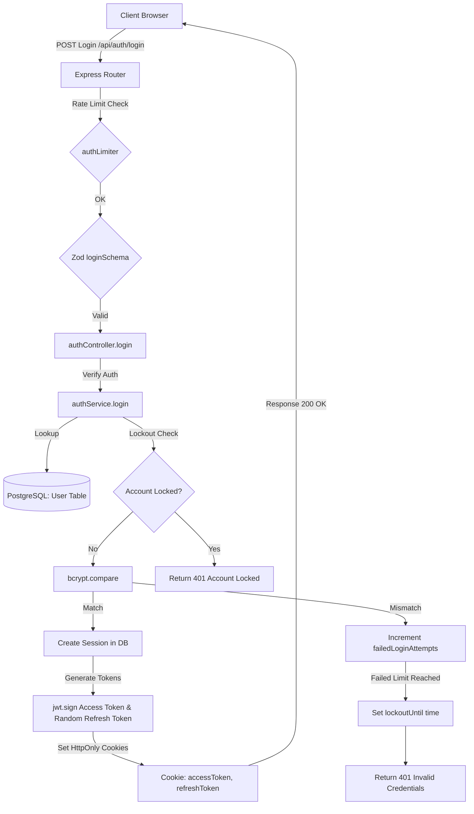

### Authorization Flow
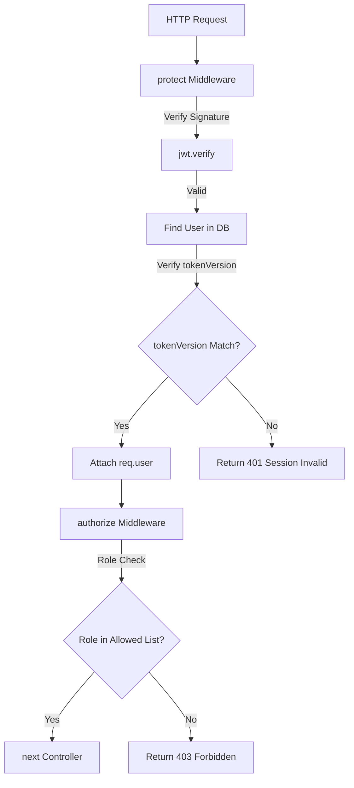

### JWT Lifecycle
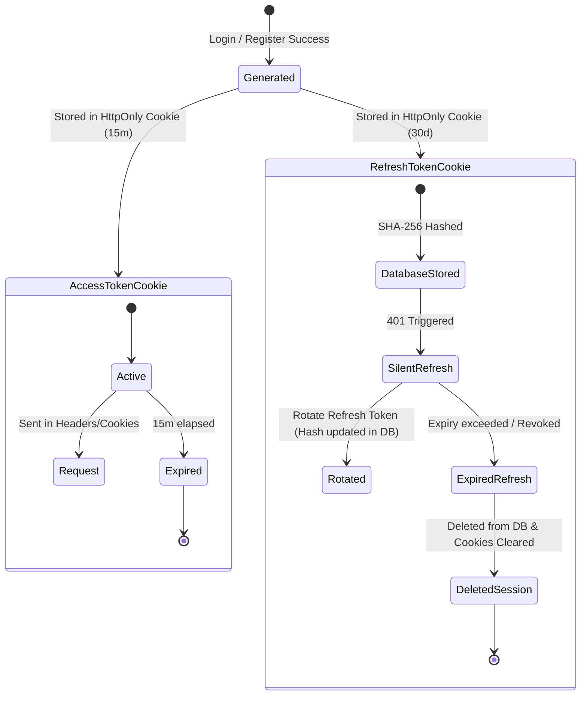

### Password Reset Flow
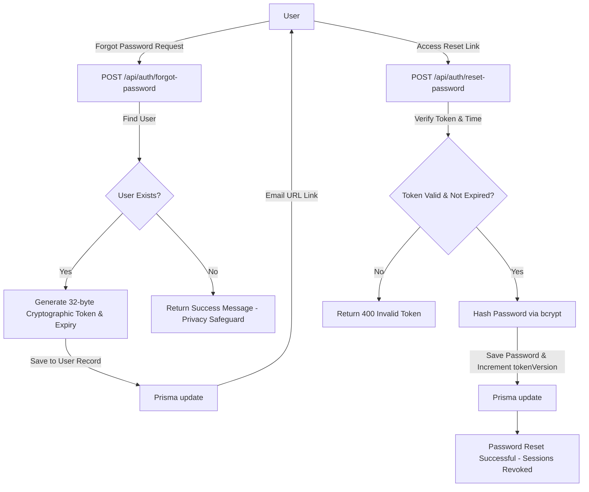

### Registration Flow
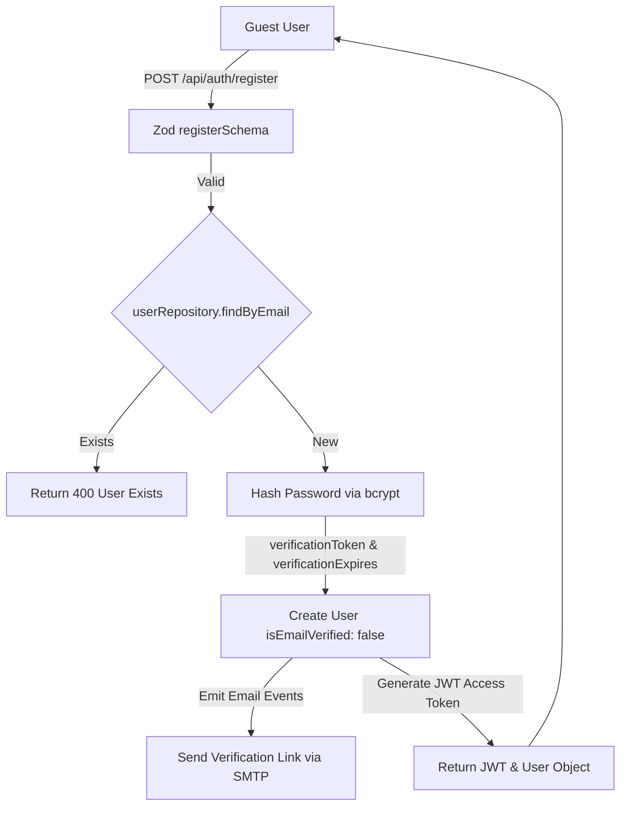

### Admin Access Flow
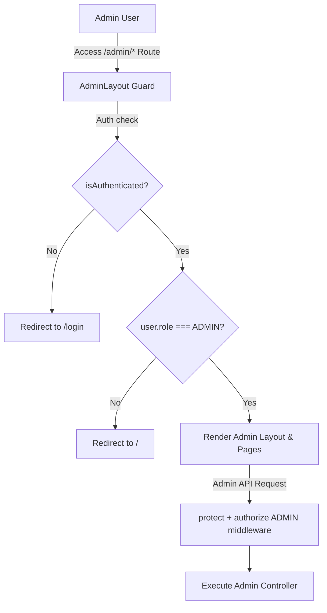

### API Security Flow
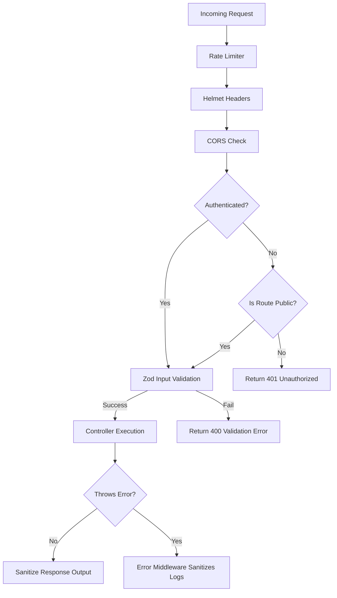

### Middleware Execution Flow
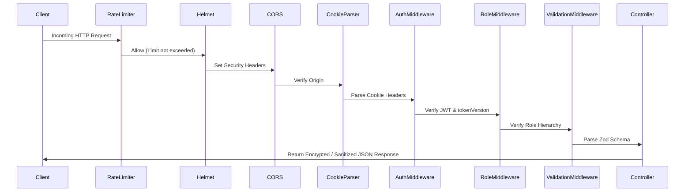

---

## 11. Sequence Diagrams (Mermaid)

### User Login
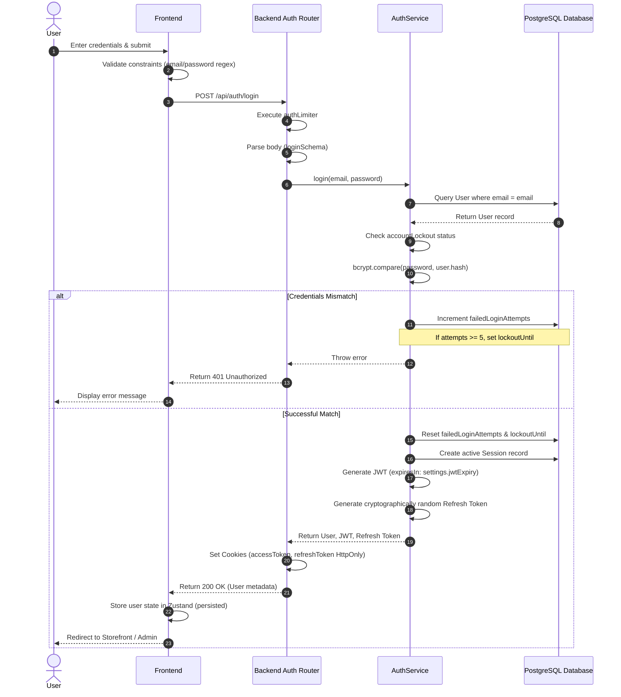

### User Registration
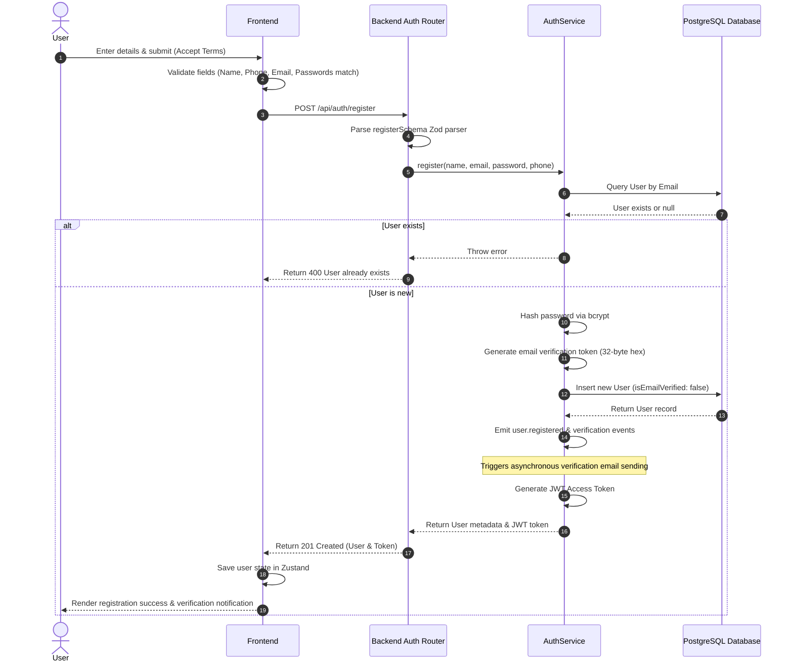

### Forgot Password
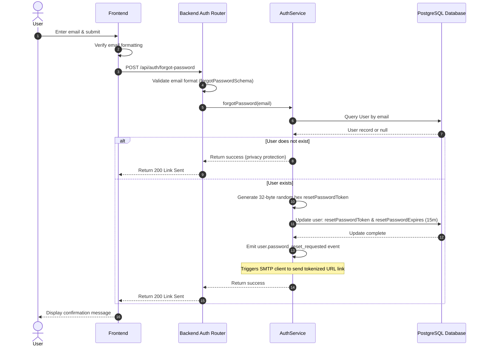

### Reset Password
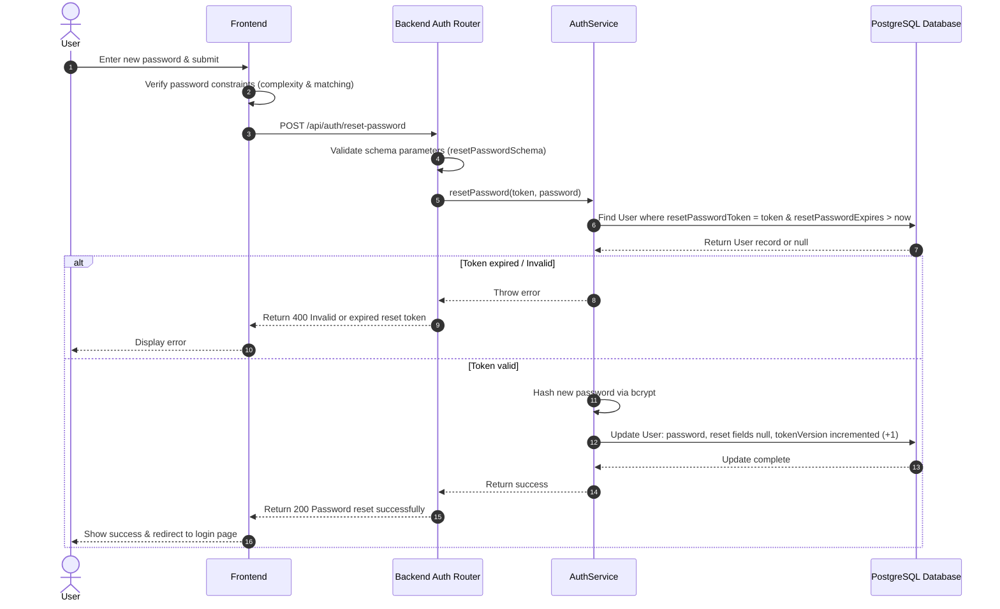

### Protected API Request
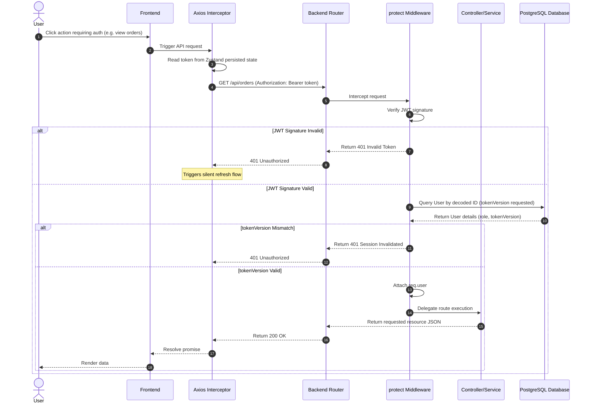

### Admin Login
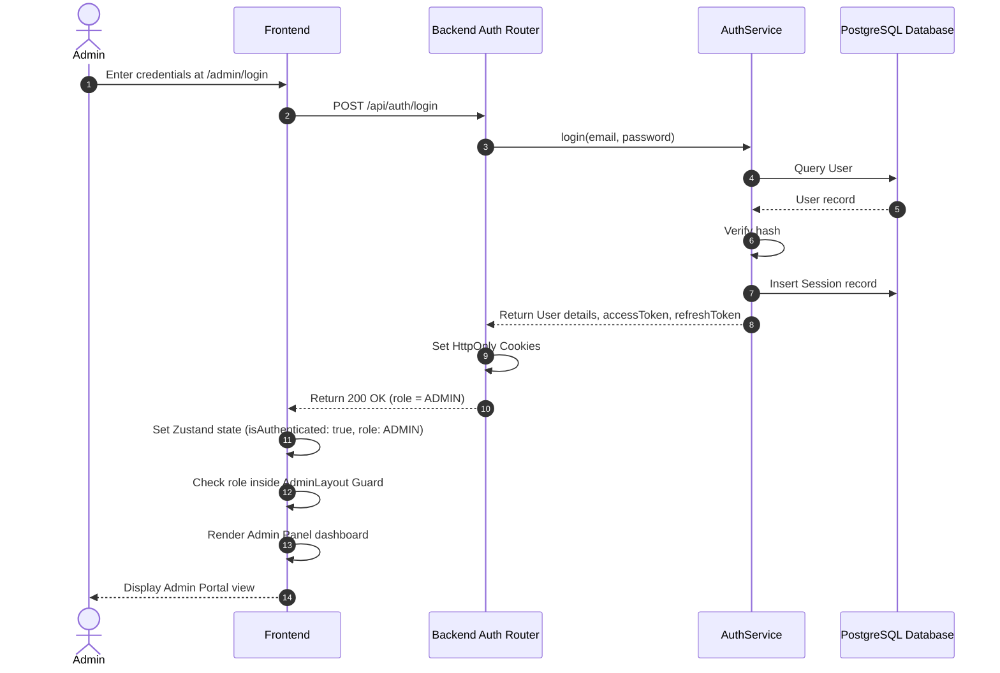

---

## 12. Project Structure Mapping

Key files containing authentication, authorization, and core security implementations:

```
c:\Users\Admin\Desktop\eCommerce
├── backend
│   ├── prisma
│   │   └── schema.prisma                       # Database Schema: User, Session, SecurityLog models
│   ├── src
│   │   ├── app.js                              # App Root: Helmet, CORS, parser registration
│   │   ├── config
│   │   │   ├── index.js                        # Environment settings exports
│   │   │   └── cloudinary.js                   # Cloudinary integration keys
│   │   ├── controllers
│   │   │   ├── authController.js               # Auth Route handlers (cookie settings)
│   │   │   ├── cookieController.js             # GDPR Cookie consent endpoints
│   │   │   └── settingsController.js           # Admin settings masking & SMTP validation
│   │   ├── middleware
│   │   │   ├── authMiddleware.js               # JWT extraction, tokenVersion validation
│   │   │   ├── errorMiddleware.js              # Server diagnostic logging & client data-leak prevention
│   │   │   ├── rateLimiter.js                  # Granular limits (Global, Auth, Admin, Read)
│   │   │   ├── roleMiddleware.js               # Implicit role validation
│   │   │   ├── uploadAvatar.js                 # Multer constraint check: Avatar files
│   │   │   ├── uploadProduct.js                # Multer constraint check: Product files
│   │   │   └── validationMiddleware.js         # Zod request validation wrapper
│   │   ├── repositories
│   │   │   ├── orderRepository.js              # Transactional order checkout logic (Luhn metadata)
│   │   │   └── userRepository.js               # User CRUD abstractions
│   │   ├── routes
│   │   │   ├── adminRoutes.js                  # Protected endpoints requiring ADMIN role
│   │   │   ├── authRoutes.js                   # Auth routing config
│   │   │   ├── securityAdminRoutes.js          # Advanced administration routes (kill sessions)
│   │   │   └── settingsRoutes.js               # Admin settings endpoints
│   │   ├── services
│   │   │   ├── authService.js                  # Core login, lockout, registration service
│   │   │   ├── auditLogger.js                  # Admin AuditLog creation
│   │   │   └── settingsService.js              # Key encryption at rest (Stripe, Razorpay, SMTP)
│   │   └── utils
│   │       ├── bcrypt.js                       # Password hashing wrapper
│   │       ├── crypto.js                       # Symmetric AES-256-GCM encryption/decryption
│   │       ├── jwt.js                          # JWT generation/verification functions
│   │       └── validators.js                   # central input validators
└── frontend
    └── src
        ├── components
        │   ├── cookies
        │   │   ├── CookieBanner.jsx            # Cookie consent alert
        │   │   ├── CookiePreferencesModal.jsx   # Cookie preference checkboxes
        │   │   └── CookieProvider.jsx          # Context synchronization with API
        │   └── layout
        │       ├── CustomerProtectedRoute.jsx  # Customer client-side route guard
        │       ├── GuestProtectedRoute.jsx     # Guest client-side route guard
        │       └── AdminLayout.jsx             # Admin-level route guard
        ├── routes
        │   └── AppRoutes.jsx                   # Route mapping and Layout configurations
        ├── services
        │   └── api.js                          # Axios interceptors (Token header & SWR refresh)
        ├── store
        │   └── authStore.js                    # Zustand credentials store (localStorage persist)
        └── utils
            └── validators.js                   # Frontend field checks (Name, Password, Phone)
```
